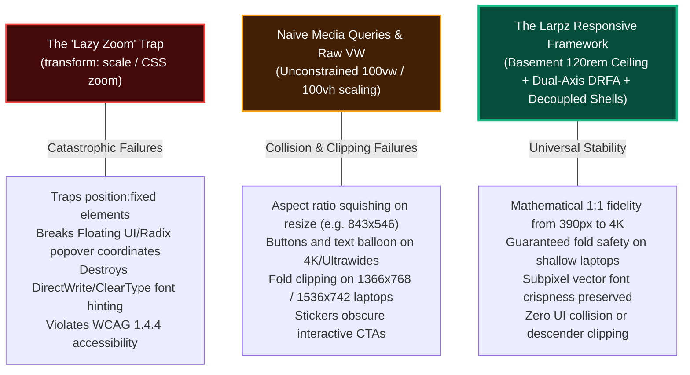

# The Responsive Architecture Method
## Dual-Axis Proportional Anchoring, Canvas Ceilings & Responsive Decoupling in LarpzWallet

```
Document: SCALPEL-LARPZ-ARCH-001
Topic: Universal Responsive Engine, Fluid Scaling Ground Truth, Decoupled Mobile Shells & Component Parity
Standard: SCALPEL QDPA (FE-003) & Basement Studio Hybrid Canvas (FE-004)
Target Codebase: C:\Websites\LARPZ-FINAL
Status: Production Architectural Standard & Execution Blueprint
Sections Governed: Hero, Features, Testimonials, FAQ, Pricing (STRICT EXCLUSION: Footer)
```

---

## 1. Executive Summary & Design Philosophy

Luxury web design—as practiced by elite studios such as **Basement Studio** (`website-2k25`), **MetaMask**, **Cash App**, and **Linear**—presents a fundamental challenge to conventional frontend responsive practices. 

Standard web development assumes responsive design is simply a matter of stacking desktop columns into vertical mobile rows via horizontal media queries (`@media (min-width: 768px)`). In modern high-craft interfaces featuring art-directed stages, floating physics stickers, custom typographic hierarchies, and full-viewport presentations, this simplistic model collapses completely.



### 1.1 Why Responsive Luxury Landing Pages Fail on Window Resizing

When engineers build an art-directed hero section or bento grid, they typically test on two discrete static screens: their primary development laptop (e.g., 1440x900 or 1536x742) and an emulated iPhone (390x844). However, when a real user resizes a browser window, tiles windows side-by-side, or operates on an atypical aspect ratio (e.g., an 843x546 window or a 3440x1440 ultrawide monitor), three distinct failure modes emerge:

1. **The Aspect Ratio Squish**:
   A desktop screen usually presents an aspect ratio between $16:10$ ($1.6$) and $16:9$ ($1.77$). When a user snaps a browser window to half their screen (e.g., $843\text{px} \times 546\text{px}$, ratio $\approx 1.54$), the layout is neither a true mobile vertical viewport nor an expansive desktop canvas. If the interface attempts to force the desktop coordinate stage onto this squished viewport, absolute elements collide, headlines run over interactive artwork, and action buttons are pushed off-screen.
2. **Raw, Unconstrained Viewport Width (`vw`) Scaling**:
   Sizing elements purely with `vw` formulas (e.g., `width: 33vw` or `calc(1rem + 4vw)`) assumes infinite vertical space is available to absorb the resulting height. On ultrawide displays ($2560\text{px}$ to $3440\text{px}$ wide), `vw`-scaled elements balloon into gigantic proportions, forcing critical content hundreds of pixels below the visible viewport.
3. **Missing Dual-Axis `min(vw, vh)` Clamping**:
   When window height is restricted (such as on 13.3" and 14" laptops with browser address bars, bookmarks bars, and OS docks leaving $\le 700\text{px}$ of usable height), width-only scaling ignores the vertical ceiling. Without checking the viewport height (`vh`), sections with `min-h-[100svh]` or fixed-height card grids inevitably clip their bottom edges.

### 1.2 The Basement Studio 120rem (1920px) Canvas Ceiling Standard

To solve ultrawide expansion while retaining full-bleed artistic atmosphere, LarpzWallet adopts the architectural standard established by **Basement Studio** (`basementstudio/website-2k25`): **The 120rem Canvas Ceiling**.

$$\text{Canvas Ceiling: } 120\text{rem} \times 16\text{px} = 1920\text{px}$$

On screens wider than $1920\text{px}$ (e.g., 1440p ultrawides at $3440\text{px}$ or 4K screens at $3840\text{px}$):
- Section backgrounds and canvas atmospheres remain **full bleed** (`100vw`).
- All layout stages, interactive coordinate systems, carousel arrow controls, bento grids, and sticker containment fields are locked to `--canvas-max-width: 120rem`.
- The content stage is centered using `mx-auto`, creating luxurious, balanced negative space margins at the screen edges rather than scattering elements thousands of pixels apart.

```css
/* app/globals.css: Basement Studio Canvas Ceiling Integration */
@media (min-width: 1024px) {
  :root {
    --canvas-max-width: 120rem; /* 1920px ceiling */
    --content-max: min(120rem, 92vw);
  }
}
```

---

## 2. The Dual-Axis Proportional Engine (SCALPEL QDPA)

The core engine powering fluid typography, proportional padding, and fold-safe geometries in LarpzWallet is the **Quantum Dynamic Proportional Architecture (QDPA)**, formally designated **SCALPEL-FE-003**.

### 2.1 The Dynamic Root Fluid Anchor (DRFA)

Rather than maintaining hundreds of fragile, independent `clamp()` declarations across dozens of components, QDPA anchors the root font-size (`:root`) to a **dual-axis fluid anchor** pegged to the real-world ground truth: a **$1536 \times 742\text{px}$ laptop display** (the canonical 15.6" Windows display at 125% scale and modern 14" MacBook viewports).

```
┌────────────────────────── GROUND TRUTH BASELINE ──────────────────────────┐
│                                                                           │
│   Logical Reference Viewport: 1536px (Width) x 742px (Height)             │
│   Reference Root Font Size:   16px                                        │
│                                                                           │
│   Width Divisor:  1536 / 16 = 96.000                                      │
│   Height Divisor: 742  / 16 = 46.375                                      │
│                                                                           │
└───────────────────────────────────────────────────────────────────────────┘
```

#### The Mathematical Engine:

$$\text{Width Factor: } W_f = \frac{100\text{vw}}{96}$$

$$\text{Height Factor: } H_f = \frac{100\text{vh}}{46.375}$$

$$\text{Dual-Axis Safety: } S_{\text{dual}} = \min(W_f, H_f)$$

$$\text{Root Font Size: } \text{clamp}(0.875\text{rem}, S_{\text{dual}}, 1.375\text{rem})$$

```css
/* app/globals.css: Production Dual-Axis Engine */
:root {
  /* 1. Mobile Quarantine (< 1024px): 100% native 16px baseline */
  font-size: 100%;
  --scale-factor: 1;
  --px: 1px;
  --canvas-max-width: 100%;
}

@media (min-width: 1024px) {
  :root {
    /* 2. Desktop Proportional Engine (>= 1024px) */
    --dpa-w-factor: calc(100vw / 96);
    --dpa-h-factor: calc(100vh / 46.375);
    --dpa-dual-axis: min(var(--dpa-w-factor), var(--dpa-h-factor));

    /* Bounded between 14px (0.875rem) and 22px (1.375rem) */
    font-size: clamp(0.875rem, var(--dpa-dual-axis), 1.375rem);

    /* Computed Scale Variables */
    --root-font-size-px: clamp(14px, min(calc(100vw / 96), calc(100vh / 46.375)), 22px);
    --scale-factor: calc(var(--root-font-size-px) / 16px);

    /* Proportional Pixel Bridge */
    --px: calc(1rem / 16);

    /* Basement Studio 120rem (1920px) Canvas Ceiling */
    --canvas-max-width: 120rem;
    --content-max: min(120rem, 92vw);
  }
}
```

#### Why Shortest-Side Safety (`min(W_f, H_f)`) is Essential:
1. **On Ultrawide Displays ($3440 \times 1440$)**: $W_f = 3440 / 96 = 35.83\text{px}$, but $H_f = 1440 / 46.375 = 31.05\text{px}$. The engine respects the height limit and caps at $1.375\text{rem}$ ($22\text{px}$), preventing astronomical text scaling.
2. **On Shallow Laptop Displays ($1536 \times 680$)**: $W_f = 16\text{px}$, but $H_f = 680 / 46.375 = 14.66\text{px}$. The engine automatically scales the root down to $14.66\text{px}$. Every rem-based card, margin, and heading compresses proportionally, guaranteeing the entire hero layout stays **100% visible above the fold without scrolling**.

### 2.2 The Proportional Pixel Bridge (`--px`)

A recurring conflict in UI engineering is that designers specify pixel-perfect values in Figma (e.g. `border-radius: 20px; border: 3px; font-size: 18px;`), whereas fluid scaling requires scalable relative units.

The **Proportional Pixel Bridge** solves this without requiring developers to manually convert every number to `rem`:

```css
/* Desktop: 1 "proportional pixel" tracks the root rem */
--px: calc(1rem / 16);

/* Mobile: 1 proportional pixel is strictly 1 physical CSS pixel */
--px: 1px;
```

#### In Component Code:
```tsx
// Using the Proportional Pixel Bridge
<div style={{
  borderRadius: `calc(20 * var(--px))`,
  border: `calc(3 * var(--px)) solid var(--color-grape)`,
  fontSize: `calc(18 * var(--px))`
}} />
```
- On a standard $1536\text{px}$ desktop: $1\text{rem} = 16\text{px} \implies \text{--px} = 1\text{px}$. The box renders at exactly $20\text{px}$ radius, $3\text{px}$ border, $18\text{px}$ font.
- On a 4K display where root scales to $22\text{px}$: $1\text{rem} = 22\text{px} \implies \text{--px} = 1.375\text{px}$. The box scales to $27.5\text{px}$ radius, $4.125\text{px}$ border, $24.75\text{px}$ font.
- On mobile ($< 1024\text{px}$): `--px` resets to `1px`, preserving strict design fidelity.

---

## 3. The Responsive Decoupling Pattern (SCALPEL-FE-002)

The single greatest source of responsive bugs on creative web pages is trying to force a complex, art-directed 2D desktop canvas into a mobile viewport using a single, unified DOM tree with dozens of conditional CSS class overrides (`lg:absolute lg:top-[20%] max-lg:relative max-lg:top-0`).

Under **SCALPEL-FE-002**, LarpzWallet implements **Responsive Decoupling**:

```
                       ┌─────────────────────────────────────┐
                       │          <Hero> Section             │
                       └──────────────────┬──────────────────┘
                                          │
                  ┌───────────────────────┴───────────────────────┐
                  ▼                                               ▼
     ┌─────────────────────────┐                     ┌─────────────────────────┐
     │      Desktop Stage      │                     │   Mobile Orchestrator   │
     │     (hidden lg:block)   │                     │    (block lg:hidden)    │
     ├─────────────────────────┤                     ├─────────────────────────┤
     │ • 120rem Canvas Ceiling │                     │ • Single-column vertical│
     │ • Absolute coordinates  │                     │ • In-flow natural stack │
     │ • Left headline anchor  │                     │ • Centered headline     │
     │ • Center phone artwork  │                     │ • Bounded phone mock    │
     │ • Right text & buttons  │                     │ • Pinned sticker badges │
     │ • Atmospheric stickers  │                     │ • Flex action buttons   │
     └─────────────────────────┘                     └─────────────────────────┘
```

### 3.1 The Desktop Stage (`hidden lg:block`)
- Dedicated to viewports $\ge 1024\text{px}$.
- Encapsulated within `mx-auto w-full max-w-[var(--canvas-max-width,120rem)]`.
- Renders elements at precise tuned coordinates using `<PriceEl>` and absolute percentage positioning:
  - Phone artwork anchored at `left: 50%`, `top: 50%` with dynamic rotation.
  - Headline anchored top-left via fluid clamp coordinates.
  - Subtitle copy and action button dock anchored to the right-side content column.
  - Atmospheric stickers freely floating across the stage canvas with multi-axis drift animations.

### 3.2 The Mobile/Tablet Orchestrator (`block lg:hidden`)
- Dedicated to viewports $< 1024\text{px}$ and squished desktop windows (e.g. 843x546).
- Replaces absolute positioning with **strict sequential in-flow vertical ordering**:
  1. **Mobile Headline**: Centered uppercase typography clamped cleanly: `clamp(34px, 8.5vw, 56px)`.
  2. **Bounded Phone Artwork**: Clamped to `max-w-[min(82vw,350px)]` and `max-h-[44vh]` with `object-contain`. It can never overwhelm the mobile screen or push buttons below the fold.
  3. **Pinned Sticker Badges**: Key decorative stickers (Lock, Balloons) are pinned directly to the phone wrapper (`absolute -top-3 -right-2`, `absolute -bottom-5 -left-3`) so they travel with the artwork and can never collide with text.
  4. **Subtitle Copy**: Centered readable body with a strict line length ceiling (`max-w-[34ch]`).
  5. **Action Button Dock**: Balanced flex button pair (`Buy` & `Login`) with touch-friendly hit states (`h-[48px] min-w-[130px] px-7`).

#### The Guarantees of Decoupling:
- **Zero Collision**: It is mathematically impossible for the headline, phone, text, or buttons to overlap on mobile or squished screens because they exist in standard CSS block flow.
- **Zero Regressions**: Tuning a coordinate on the desktop stage in `/hero-tuner` will never break the mobile layout, and refining mobile padding will never shift desktop coordinates.

---

## 4. Button Architecture & Dead-Centering

The action buttons across LarpzWallet (`Buy`, `Login`, `Get Started`, `Try It Free`, `Buy Lifetime`) represent a masterclass in micro-typography, spring mechanics, and mathematical centering.

```
                  ┌──────────────────── PILL BUTTON ARCHITECTURE ────────────────────┐
                  │                                                                  │
                  │   .pill-btn (Root <a> or <button>)                               │
                  │   ┌──────────────────────────────────────────────────────────┐   │
                  │   │  .pill-btn__fill (Absolute expanding circle background)  │   │
                  │   │  ┌────────────────────────────────────────────────────┐  │   │
                  │   │  │  .pill-btn__holder (height: 1.5em; overflow: hidden)│  │   │
                  │   │  │  ┌──────────────────────────────────────────────┐  │  │   │
                  │   │  │  │ .pill-btn__main (slides to -1.5em on hover)   │  │  │   │
                  │   │  │  │ .pill-btn__hover (slides to 0 on hover)       │  │  │   │
                  │   │  │  └──────────────────────────────────────────────┘  │  │   │
                  │   │  └────────────────────────────────────────────────────┘  │   │
                  │   └──────────────────────────────────────────────────────────┘   │
                  └──────────────────────────────────────────────────────────────────┘
```

### 4.1 The Dead-Centering Problem & Descender Clipping

When an engineer builds an animated roll button with `overflow: hidden`, a subtle typographic disaster usually occurs: **descender clipping**.

```
   Normal Line Box (leading-none):           Protected Line Box (height: 1.5em):
   ┌─────────────────────────────┐           ┌─────────────────────────────┐
   │        L o g i n            │           │                             │
   └───────────────┴─────────────┘           │        L o g i n            │
             (g descender cut off!)          │                             │
                                             └─────────────────────────────┘
                                                (Descenders completely safe)
```

1. Glyphs do not fit into their nominal font-size: on an $18\text{px}$ font, the capital letters and ascenders reach upward while lowercase descenders (`g`, `y`, `p`, `j`) extend downward, spanning over $22\text{px}$ of total vertical height.
2. If the button or holder declares `leading-none` (`line-height: 1`), the line box collapses to exactly $18\text{px}$. The letter `g` has its bottom $1.7\text{px}$ truncated by `overflow: hidden`.
3. If the button applies naive vertical padding, the button may appear centered, but the internal animated roll mechanism becomes misaligned.

#### The Larpz Solution (`components/pillHover.tsx`):
- Root: `display: inline-flex; align-items: center; justify-content: center; text-align: center; border-radius: 9999px;`
- Holder: `height: 1.5em; line-height: 1.5; overflow: hidden; display: inline-flex; align-items: center; justify-content: center;`
- Main & Hover Spans: Both set to `height: 1.5em; line-height: 1.5;`.
- **Result**: Ascenders and descenders are guaranteed 100% clearance at any font size, while the text remains mathematically dead-centered in the pill.

### 4.2 Typography & Kerning Standards
- **Font**: Neue Montreal, Weight 600 (SemiBold).
- **Casing**: Title Case (`Buy`, `Login`, `Get Started`, `Try It Free`). Title case provides superior optical legibility over raw uppercase on rounded pill capsules.
- **Tracking**: Natural kerning (`0` to `+0.01em`). Uppercase buttons must use `+0.03em` to `+0.05em` to prevent glyph crowding.

### 4.3 Bounded Dimensional Clamps
To prevent buttons from shrinking to unreadable pills on compact screens or ballooning into oblong logs on 4K displays, all primary buttons are bounded by strict minimum and maximum dimensional thresholds:

| Property | Minimum Constraint | Maximum Constraint | Target Baseline (1536x742) |
| :--- | :--- | :--- | :--- |
| **Button Width** | `minWidth: 120px` | `maxWidth: 210px` | $\approx 140\text{px} - 160\text{px}$ |
| **Button Height** | `minHeight: 46px` | `maxHeight: 56px` | $48\text{px} - 52\text{px}$ |
| **Font Size** | `15px` | `18px` | $16\text{px} - 17\text{px}$ |

### 4.4 The MetaMask Spring Hover Roll

LarpzWallet features the authentic **MetaMask.io spring hover interaction** measured directly from production computed styles:

1. **Expanding Fill Circle**:
   - Scales from `scale(0)` to `scale(1.03)` with `border-radius: 100px`.
   - The $1.03$ scale overshoots the pill boundary, eliminating any surviving hairline rim of the previous background.
   - Uniform `scale()`, **never `scaleY()`** (which collapses into an unsightly horizontal line on exit).
2. **Signature Spring Overshoot Curve**:
   - Entrance: `cubic-bezier(0.4, 1.35, 0.5, 0.97)` over $0.55\text{s}$. The $1.35$ value exceeds $1.0$, producing the characteristic tactile bounce.
   - Exit: Plain smooth ease `cubic-bezier(0.33, 0, 0.67, 1)` over $0.4\text{s}$ (no reverse spring, which snaps past zero).
3. **Asymmetric Timing**:
   - Opacity runs at half the duration of the transform ($0.275\text{s}$ vs $0.55\text{s}$). The color swap finishes while the physical motion is still settling.
4. **Dual Text Roll**:
   - The resting label translates $0 \implies -1.5\text{em}$.
   - The hover label translates $+1.5\text{em} \implies 0$.
   - Because travel matches the $1.5\text{em}$ line-height exactly, no sliver of outgoing text remains visible.

---

## 5. Sticker Containment & Anti-Collision Laws

Floating visual stickers (such as the balloons, lock, screenshots, and badges) provide LarpzWallet with its distinctive, tactile aesthetic. However, unconstrained decorative elements represent a severe UX hazard if they obscure readable copy or block user interactions.

```
       ┌──────────────────────── ANTI-COLLISION LAWS ────────────────────────┐
       │                                                                      │
       │   LAW 1: STAGE ISOLATION                                             │
       │   Floating stickers must NEVER be positioned relative to document.   │
       │   They must anchor inside the 120rem max-width canvas stage.         │
       │                                                                      │
       │   LAW 2: ZERO INTERACTION BLOCKING                                   │
       │   All sticker containers must declare pointer-events-none.           │
       │   CTAs and inputs must remain clickable under all conditions.        │
       │                                                                      │
       │   LAW 3: RESPONSIVE QUARANTINE                                       │
       │   On viewports < 1024px, free-floating stickers that traverse text   │
       │   paths MUST be hidden (hidden lg:block) or converted into pinned    │
       │   corner badges anchored directly to card headers or phone frames.   │
       │                                                                      │
       └──────────────────────────────────────────────────────────────────────┘
```

### 5.1 Sticker Containment Architecture
1. **Desktop Stage Coordinate Locking**:
   In every section (`Hero`, `Features`, `Testimonials`, `Faq`, `Pricing`), floating stickers are placed inside a container with `pointer-events-none absolute inset-0 max-w-[var(--canvas-max-width,120rem)] mx-auto`.
   - Percentage coordinates (`x: 27.1%`, `y: 9.1%`) resolve against the bounded 120rem stage.
   - On ultrawide displays ($3440\text{px}$), stickers remain anchored tightly around the content cards rather than drifting off into the monitor periphery.
2. **Composited Multi-Period Float Physics**:
   Stickers animate via pure GPU-composited 3D transforms (`translate3d` and `rotate`). They never animate `top` or `left`, eliminating layout recalculations.
   - Vertical rise (`--rise: 12px`) and horizontal drift (`--drift: 6px`) run on incommensurate periods (e.g. $9\text{s}$ vs $11\text{s}$), ensuring the floating path never settles into a predictable, repetitive loop.
3. **Mobile & Tablet Isolation**:
   - Any sticker whose position could intersect with text on smaller viewports is quarantined behind `hidden lg:block`.
   - Essential stickers (such as the Hero lock and balloon stickers) are detached from global coordinates and pinned as relative sub-elements of the central phone card (`-top-3 -right-2 w-[28%]`).

---

## 6. Section-by-Section Execution Plan for Remaining Sections

With the Hero section serving as the verified reference implementation of this architecture, the remaining sections must be standardized against these exact rules.

```
┌─────────────────────────────────────────────────────────────────────────────┐
│ ⚠ STRICT ARCHITECTURAL BOUNDARY: FOOTER EXCLUSION                           │
│ sections/Footer.tsx, components/FooterCoins.tsx, and                        │
│ components/TicketStrip.tsx represent a completed, calibrated system with    │
│ verified cloud apex anchoring, mobile 18svh ticket perforations, and 52-coin│
│ physics. UNDER NO CIRCUMSTANCES SHOULD THE FOOTER BE ALTERED.               │
└─────────────────────────────────────────────────────────────────────────────┘
```

---

### Section 2: Features Section (`sections/Features.tsx` & `components/Card.tsx`)

#### 1. Architectural Diagnosis:
- Section 2 features an **Embla click-carousel** with 6 bento cards.
- On ultrawide displays ($> 1920\text{px}$), carousel controls and track padding can drift outward toward the screen edges if uncontained.
- Inside Card 1 (`settingcust.webm`) and Card 4 (`idek.webm`), the video assets represent vertical iPhone interfaces. Because cards declare `[container-type:inline-size]` and `object-contain`, variations in card aspect ratio previously caused the top rounded border of the iPhone mockup to clip against the card's upper corner radius.

```
       Card Upper Radius:
       ╭─────────────────────────────╮
       │      [ iPhone Screen ]      │ ◄── Without offset: top corners clip!
       │                             │
       │                             │
       │  ▼ With down: 6cqw offset:  │
       │  ╭───────────────────────╮  │
       │  │    [ iPhone Screen ]  │  │ ◄── Clears card radius perfectly
       │  │                       │  │
```

#### 2. Standardized Execution:
1. **Carousel Control Bounds in 120rem Ceiling**:
   Lock the controls and Embla track wrapper inside the 120rem canvas ceiling:
   ```tsx
   // sections/Features.tsx
   <div className="mx-auto w-full max-w-[var(--canvas-max-width,120rem)]">
     <div className="mb-[clamp(20px,1rem+1.5vh,40px)] flex justify-end gap-(--space-xs) px-[clamp(20px,1rem+2vw,48px)]">
       <Arrow dir="prev" onClick={prev} disabled={!canPrev} />
       <Arrow dir="next" onClick={next} disabled={!canNext} />
     </div>
     <div ref={emblaRef} className="w-full overflow-hidden">
       {/* Embla track */}
     </div>
   </div>
   ```
2. **iPhone Cut-Off Defense (`down: 6cqw`)**:
   In `components/Card.tsx`, support container-relative offsets for video media:
   ```tsx
   // components/Card.tsx
   <video
     src={media.src}
     style={{
       translate: `-50% calc(-50% + ${media.down || "0px"})`,
     } as React.CSSProperties}
     className="absolute top-1/2 left-1/2 block aspect-square w-[88%] max-w-none -translate-x-1/2 -translate-y-1/2 object-contain"
   />
   ```
   - Card 1 and Card 4 declare `down: "6cqw"`. The `6cqw` unit ($6\%$ of the card's inline container width) scales precisely with the card on mobile, tablet, and desktop, keeping the iPhone mockup centered without clipping.
3. **Sticker Responsive Isolation**:
   Stickers in `FEATURES_STICKERS` must be wrapped in `pointer-events-none absolute hidden lg:block` to ensure mobile horizontal drag gestures on the Embla carousel are never obstructed.

---

### Section 3: Testimonials Section (`sections/Testimonials.tsx`)

#### 1. Architectural Diagnosis:
- Two continuous marquee rows moving in opposite directions (`40s` forward, `52s` reverse).
- On shallow laptop viewports (e.g., $1536 \times 742$ with browser chrome leaving $\approx 640\text{px}$ usable height), two stacked marquee rows with unconstrained heights exceed `--section-fill`, causing vertical page overflow and scroll snapping stutter.
- Unconstrained marquee text on ultrawide displays can lead to over-elongated cards.

#### 2. Standardized Execution:
1. **1536x742 Laptop Card Height Clamping**:
   Apply dual-axis mathematical clamping to the testimonial card height:
   ```tsx
   // sections/Testimonials.tsx
   <li className="flex h-[clamp(170px,min(12rem+6.5vw,calc((var(--section-fill)-clamp(24px,1rem+1.4vw,44px)-2rem)/2)),360px)] w-[clamp(280px,17rem+9.5vw,500px)] shrink-0 flex-col rounded-[20px] bg-[#3D065F] p-[clamp(20px,1.2rem+1.4vw,36px)] text-[#EAC2FF]">
   ```
   - The term `calc((var(--section-fill) - gap - 2rem) / 2)` guarantees that both rows plus the gap fit inside the available section fill on short laptop viewports, completely eliminating vertical overflow.
2. **Quote Typography Clamp**:
   ```tsx
   <p className="line-clamp-4 text-[clamp(15px,min(0.95rem+0.7vw,2.2vh),24px)] leading-[1.35]">
     {t.quote}
   </p>
   ```
   - Sized via `min(..., 2.2vh)` so font size compresses on shallow screens, preventing the 4th line from colliding with the author footer.
3. **Ultrawide Marquee Containment**:
   The marquee track wrapper runs full bleed for cinematic travel, but the floating sticker field and section gutters are bounded by `max-w-[var(--canvas-max-width,120rem)] mx-auto`.

---

### Section 4: FAQ Section (`sections/Faq.tsx` & `components/FaqItem.tsx`)

#### 1. Architectural Diagnosis:
- Desktop: 6 interactive pills scattered around a massive centered `FAQ` wordmark.
- Interactive GSAP physics: Opening a pill causes it to expand (`openW: 520px`), lift upward (`targetLift = -grown * 0.42`), and push neighboring pills away radially (`PUSH = 54px`).
- **Hazard**: On compact desktops ($1024\text{px} - 1280\text{px}$), radial push physics can force edge pills (`x: 6.3%`, `x: 78.8%`) outside the screen boundary or cause them to collide with the centered `FAQ` text.

```
       Compact Desktop (1024px) Collision Hazard:
       ┌───────────────────────────────┐
       │ (Pill 1) ◄── [ PUSHED OUT! ]  │
       │          ┌─────────┐          │
       │          │   FAQ   │          │  ◄── Must clamp X/Y push boundaries
       │          └─────────┘          │
       │  [ PUSHED OUT! ] ──► (Pill 6) │
       └───────────────────────────────┘
```

#### 2. Standardized Execution:
1. **Desktop Scatter Bounds in 120rem**:
   The desktop scatter canvas is encapsulated in `max-w-[var(--canvas-max-width)] relative mx-auto overflow-hidden`.
2. **GSAP Push Boundary Clamping (1024px - 1280px)**:
   In `sections/Faq.tsx`, the `move()` physics function clamps computed target translations against root stage rects:
   ```ts
   // Safe boundary margin within the desktop stage
   const marginX = Math.max(24, rootRect.width * 0.03);
   const marginY = 16;

   // Clamping X translation
   const minTargetX = marginX - restingLeft;
   const maxTargetX = rootRect.width - marginX - restingRight;
   const clampedX = minTargetX <= maxTargetX
     ? Math.max(minTargetX, Math.min(maxTargetX, rawTargetX))
     : rawTargetX;

   // Clamping Y translation
   const minTargetY = marginY - restingTop;
   const maxTargetY = rootRect.height - marginY - restingBottom;
   const clampedY = minTargetY <= maxTargetY
     ? Math.max(minTargetY, Math.min(maxTargetY, rawTargetY))
     : rawTargetY;
   ```
   - Edge pills are physically constrained from escaping the stage canvas.
3. **Central Wordmark Opacity Tuning**:
   The central `FAQ` wordmark applies `opacity-20 xl:opacity-100 transition-opacity duration-300`. On compact laptops where pills sit closer to the center, reduced wordmark opacity guarantees 100% legibility of pill text even during overlap.
4. **Mobile & Tablet Stacked Accordion (`lg:hidden`)**:
   Below $1024\text{px}$, the scatter canvas disengages into a clean, centered vertical accordion stack (`max-w-lg flex flex-col items-center gap-3`).

---

### Section 5: Pricing Section (`sections/Pricing.tsx`)

#### 1. Architectural Diagnosis:
- Three pricing tier cards (`Starter`, `Monthly`, `Lifetime`) in a horizontal row on desktop.
- On shallow laptop screens ($1536 \times 742$), static card heights ($640\text{px}$) plus section heading padding ($195\text{px}$) total $835\text{px}$, forcing cards to spill over the bottom fold.
- Static price font sizes (`size: 62px`) can look disproportionately large when cards compress horizontally between $1024\text{px}$ and $1150\text{px}$.

#### 2. Standardized Execution:
1. **1536x742 Laptop Card Height Bounds**:
   Clamp the desktop card height to `--section-fill` minus padding:
   ```tsx
   // sections/Pricing.tsx
   <li className="w-full max-w-[380px] min-w-0 flex-1 rounded-[20px] border-[3px] border-grape bg-grape aspect-[360/500] sm:aspect-[360/480] lg:max-w-none lg:aspect-auto lg:h-[min(calc(640px*var(--scale-factor,1)),calc(var(--section-fill)-2rem))]">
   ```
   - On tall screens, cards scale proportionally via `var(--scale-factor)`.
   - On short laptops, `calc(var(--section-fill) - 2rem)` dynamically constrains card height so the entire pricing table remains visible above the fold.
2. **Price Fluid Clamp**:
   Replace static font sizes in `CARDS` data with container-relative fluid clamps:
   ```ts
   // Card price element
   { 
     name: "text 2", 
     kind: "text", 
     text: "$44", 
     size: "clamp(44px, 3.8cqw + 24px, 62px)", 
     align: "left", 
     color: "var(--color-violet)" 
   }
   ```
   - Uses container query units (`cqw`) so the price font scales smoothly with card width.
3. **CTA Button Parity**:
   All pricing action buttons (`Get Started`, `Try It Free`, `Buy Lifetime`) are rendered through `<PriceEl>` with:
   - `btn: true` enabling MetaMask spring hover mechanics.
   - Bounded width and height constraints (`minWidth: 120px, maxWidth: 210px, minHeight: 46px, maxHeight: 56px`).
   - Title Case typography with `font-semibold` and natural kerning.

---

## 7. Developer Rules of Engagement & QA Verification Matrix

To ensure that future features, marketing banners, or agentic code changes maintain the integrity of this framework, all frontend engineers must adhere to the following rules:

### 7.1 The Seven Unbreakable Rules

| Rule # | Name | Mandate |
| :---: | :--- | :--- |
| **I** | **The Ceiling Law** | Every desktop stage or interactive track must be bounded by `max-w-[var(--canvas-max-width,120rem)] mx-auto`. Never let layout stages stretch unconstrained across 4K displays. |
| **II** | **The Dual-Axis Law** | Never size viewport-critical containers with `vw` alone. Always balance width scaling with height safety: `min(calc(100vw/96), calc(100vh/46.375))`. |
| **III** | **The Decoupling Law** | Never compromise desktop art direction with messy conditional overrides. Decouple into a dedicated Desktop Stage (`hidden lg:block`) and Mobile Orchestrator (`block lg:hidden`). |
| **IV** | **The Descender Law** | Every pill button clipping container must enforce `height: 1.5em; line-height: 1.5;`. Single-line button text must never use raw `leading-none` without this protection. |
| **V** | **The Proportional Pixel Law** | In desktop components, scale fixed pixel values using `calc(N * var(--px))`. Never hardcode static pixel values for elements that must scale on 4K displays. |
| **VI** | **The Sticker Containment Law** | Floating stickers must always declare `pointer-events-none` and remain bounded within their parent stage. Never allow decorative stickers to obscure CTAs on mobile. |
| **VII** | **The Footer Quarantine** | `sections/Footer.tsx`, `components/FooterCoins.tsx`, and `components/TicketStrip.tsx` are strictly read-only. No changes are permitted to the footer ecosystem. |

---

### 7.2 Multi-Viewport QA Verification Matrix

Every pull request or major layout update must be validated against the following standard test viewports:

```
┌─────────────────────────────────────────────────────────────────────────────┐
│                      GOLDEN TEST VIEWPORT CHECKLIST                         │
├─────────────────────┬───────────────────┬───────────────────────────────────┤
│ Viewport Category   │ Resolution (WxH)  │ Critical Acceptance Criteria      │
├─────────────────────┼───────────────────┼───────────────────────────────────┤
│ Small Mobile        │ 390 x 844 (iPhone)│ • Mobile orchestrator active      │
│                     │                   │ • Phone art bounded (max-h 44vh)  │
│                     │                   │ • Buttons stacked / full width    │
│                     │                   │ • Zero horizontal scrollbar       │
├─────────────────────┼───────────────────┼───────────────────────────────────┤
│ Tablet Portrait     │ 768 x 1024 (iPad) │ • Mobile orchestrator active      │
│                     │                   │ • Centered headline legible       │
│                     │                   │ • Free-floating stickers hidden   │
├─────────────────────┼───────────────────┼───────────────────────────────────┤
│ Squished Desktop    │ 843 x 546 (Half)  │ • Mobile orchestrator active      │
│                     │                   │ • Zero overlap between art & text │
│                     │                   │ • CTA buttons completely visible  │
├─────────────────────┼───────────────────┼───────────────────────────────────┤
│ Compact Laptop      │ 1024 x 600        │ • Desktop stage active            │
│                     │                   │ • FAQ pills clamped within screen │
│                     │                   │ • Wordmark opacity drops to 20%   │
├─────────────────────┼───────────────────┼───────────────────────────────────┤
│ Ground Truth Laptop │ 1536 x 742 (1080p)│ • 1:1 design match to baseline    │
│                     │                   │ • All section content in fold     │
│                     │                   │ • Pricing cards fit without scroll│
├─────────────────────┼───────────────────┼───────────────────────────────────┤
│ 1440p Standard      │ 2560 x 1440       │ • Scaled proportionally via QDPA  │
│                     │                   │ • Subpixel font rendering crisp   │
│                     │                   │ • Button sizes bounded by clamp   │
├─────────────────────┼───────────────────┼───────────────────────────────────┤
│ Ultrawide / 4K      │ 3440 x 1440       │ • 120rem canvas ceiling enforced  │
│                     │ 3840 x 2160       │ • Balanced negative space margins │
│                     │                   │ • Stickers contained near content │
└─────────────────────┴───────────────────┴───────────────────────────────────┘
```

---

## 8. Architectural Summary

By unifying the **Basement Studio 120rem Canvas Ceiling**, the **SCALPEL QDPA Dual-Axis Engine**, and the **SCALPEL-FE-002 Responsive Decoupling Pattern**, LarpzWallet achieves complete immunity from window resizing bugs, aspect ratio squishing, and 4K distortion.

The Hero section stands as the completed reference standard. Adhering to this methodology across Features, Testimonials, FAQ, and Pricing guarantees that the entire application operates at the highest tier of international frontend craftsmanship.
