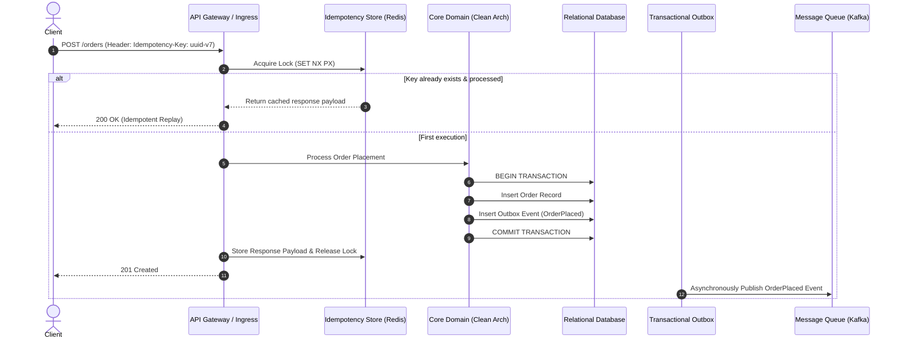
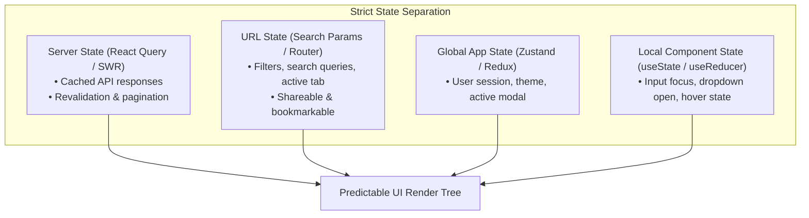

# The 10/10 Standard: From "Make It Work" to "Maintainable, Scalable, Resilient"

```
Document: SCALPEL-MAN-001
Topic: Engineering Mindset & Operational Standard
Status: Active Standard
Target Audience: Senior Engineers, Tech Leads, Autonomous AI Agents
```

---

## 1. The Core Thesis

Every software project begins with a simple question: *"How do we make this work?"*

Junior developers stop the moment the answer is "yes." They see an API return a `200 OK`, a UI component render on screen, or a test pass on their local machine, and declare the task complete.

**Senior developers operate on an entirely different plane.** They understand that getting code to work is merely the baseline prerequisite—it is the first 20% of the work. The remaining 80% is answering three ruthless questions:
1. **How does this fail?** (Resilience)
2. **How does this behave under 100x traffic or concurrent mutations?** (Scalability)
3. **Can an engineer with zero context safely modify or delete this two years from now?** (Maintainability)

This document establishes the foundational standard for **Project SCALPEL**.

---

## 2. The Three Levels of Engineering Maturity

```mermaid
journey
    title The Developer Maturity Curve
    section Phase 1: Junior (3/10)
      Solve immediate problem: 5: Me
      Ignore edge cases: 1: Me
      Write synchronous blocking code: 2: Me
      Hope production doesn't crash: 1: Me
    section Phase 2: Mid-Level (6/10)
      Apply design patterns blindly: 4: Me
      Write tests for coverage metrics: 4: Me
      Handle known errors with try/catch: 5: Me
      Query database via ORM defaults: 3: Me
    section Phase 3: SCALPEL 10/10 Senior
      Design for failure & idempotency: 9: Me
      Strict boundary & state isolation: 9: Me
      Zero N+1 & audit query plans: 9: Me
      Optimize INP, LCP & sub-system decoupled messaging: 10: Me
```

### Level 1: Junior (Score 1 - 4) — "The Optimist"
* Assumes the network is reliable, the database is fast, and the client sends valid data.
* Mixes business logic directly inside HTTP route controllers or UI components.
* Relies on unhandled exceptions and silent console logs.
* Mutates state globally and unpredictably.

### Level 2: Mid-Level (Score 5 - 7) — "The Implementer"
* Writes clean code according to team conventions.
* Adds unit tests, but mocks everything to the point where tests verify implementation details rather than business behavior.
* Catches errors, but converts them into generic `500 Internal Server Error` responses.
* Uses ORMs efficiently for single records, but introduces silent N+1 query cascades in list endpoints.
* Manages UI state with a global store, causing cascading re-renders across unaffected component trees.

### Level 3: SCALPEL 10/10 Standard (Score 8 - 10) — "The Systems Architect"
* **Defensive by Default:** Every external dependency (database, third-party API, disk) is assumed to fail or degrade.
* **Idempotent by Design:** Every mutating operation can be retried ten times without corrupting state or duplicating records.
* **Decoupled Architecture:** Business logic is pure and decoupled from frameworks, transport layers (HTTP/gRPC), and persistence mechanisms (PostgreSQL/Redis).
* **Predictable Reactivity:** Frontend state is strictly partitioned; Core Web Vitals are monitored and defended against performance regressions.
* **Self-Verifying:** CI/CD pipelines enforce static typing, security vulnerability scans, mutation testing, and architectural boundary checks before any human review.

---

## 3. Universal Foundations: The Cross-Stack Disciplines

Regardless of whether you write TypeScript, Go, Rust, or Python, a 10/10 engineer adheres to four non-negotiable principles:

### 1. SOLID as an Economic Tool (Not Academic Dogma)
SOLID is not an abstract exam question; it is a financial risk-management framework.
* **Single Responsibility (SRP):** An entity should have one, and only one, reason to change. If changing your billing calculation requires editing your email notification code, your architecture is already bankrupt.
* **Open/Closed (OCP):** You should be able to introduce a new payment provider or tax rule by adding a new class or module—never by adding another `switch` statement to a 600-line function.
* **Liskov Substitution (LSP):** Subtypes must honor the contracts of their base types without throwing unexpected `NotImplementedError` or altering behavioral preconditions.
* **Interface Segregation (ISP):** Clients must not be forced to depend on interfaces they do not use. Prefer small, composable, single-method interfaces (`Reader`, `Writer`, `Validator`).
* **Dependency Inversion (DIP):** High-level business logic must never depend on low-level database drivers or third-party SDKs. Both must depend on abstractions (interfaces).

### 2. Testability via Dependency Injection (DI)
Code is not testable because you wrote tests; **code is testable because its architecture permits isolation**.
* Hardcoded instantiations (`new StripeClient()`, `db.connect()`) within domain logic make automated testing a nightmare of monkey-patching.
* 10/10 code injects all external side effects via constructors or factory arguments. This enables:
  - Lightning-fast unit tests using in-memory fakes.
  - Integration tests running against real ephemeral Docker containers (Testcontainers).
  - Deterministic simulation of network timeouts, disk exhaustion, and third-party rate limits.

### 3. Flawless, Graceful Error Handling
In 10/10 code, errors are **first-class domain citizens**, not accidental program crashes.
* **No Silent Failures:** Never write an empty `catch` block or log an error without deciding whether to recover, rethrow, or propagate.
* **No Leaked Abstractions:** A database timeout or internal SQL syntax error must never leak to an external API response. Internal details are logged with structured correlation IDs; clients receive sanitized, typed domain errors (e.g., `PAYMENT_GATEWAY_TIMEOUT`, `ORDER_ALREADY_SETTLED`).
* **Result / Either Types:** Prefer returning explicit Result types (`Result<T, E>`) for expected domain failures (validation failed, insufficient balance) over throwing exceptions that break execution flow.

### 4. Zero-Bypass CI/CD Quality Control
Human code review should discuss architecture, business alignment, and performance trade-offs—not formatting or linting.
* Every commit is automatically validated against:
  - **Strict Type Checking:** No `any` escapes in TypeScript, no untyped dynamic dispatch in Python.
  - **Deterministic Formatting & Linting:** Biome, ESLint, Ruff, Golangci-lint running on pre-commit hooks and CI.
  - **Security Audits (SAST):** Automated vulnerability scanning for dependencies and code patterns (Semgrep, Trivy, Dependabot).
  - **Dead Code & Circular Dependency Detection:** Automated rejection of cyclic imports and unused abstractions.

---

## 4. The Backend Standard: Data Integrity & Scalability

Backend engineering is measured by **system predictability, data correctness, and throughput**.



### 1. Mandatory Mutating API Idempotency
Network requests fail. Mobile apps drop connection. Payment gateways timeout and clients retry.
* A 10/10 backend guarantees that sending the same `POST /api/v1/payments` request 5 times results in **exactly one financial charge**.
* Implement cryptographic idempotency keys passed in HTTP headers (`Idempotency-Key`).
* Atomic storage of key reservation, payload hashing, and response caching ensures duplicate requests return the original outcome without executing business logic twice.

### 2. High-Performance Relational Data Access
* **Zero N+1 Queries:** Loading 50 orders must never trigger 50 subsequent queries to load each customer. Batch loaders, dataloaders, or SQL `JOIN` / `IN (...)` queries are strictly enforced.
* **Index on Query Predicates:** Every query filtered by `WHERE`, joined by `ON`, or sorted by `ORDER BY` must be backed by an audited index.
* **Explain Analyze Routine:** Slow queries (>50ms) are inspected using query execution plans to identify sequential scans, buffer bloat, and improper join algorithms.

### 3. Defensive Resilience Patterns
* **Circuit Breakers:** If an external partner API begins failing, the circuit breaker opens immediately, returning a graceful fallback instead of exhausting server connection pools.
* **Rate Limiting & Shedding:** Token bucket or sliding window rate limiters protect the system from traffic spikes, scraping bots, and DDoS scenarios.
* **Bulkheading:** Isolate critical system resources so a spike in image processing does not starve authentication or checkout endpoints.

### 4. Asynchronous Event-Driven Decoupling
* The main HTTP request thread should only perform operations that are strictly required for the immediate synchronous response.
* Heavy computations, email deliveries, webhooks, search indexing, and audit logging are offloaded asynchronously via message brokers (Kafka, RabbitMQ).
* **Transactional Outbox Pattern:** Ensures database updates and event publishing are atomically linked in the same transaction, eliminating dual-write inconsistencies.

---

## 5. The Frontend Standard: UX Polish & UI Predictability

Frontend engineering is measured by **responsiveness, frame budget, and accessibility**.



### 1. Strict State Isolation (The 4-Tier Hierarchy)
The number one cause of frontend spaghetti is stuffing server data into global state.
* **Server State:** Handled exclusively by dedicated caching libraries (TanStack Query, SWR, RTK Query). Automatically manages caching, deduping, background invalidation, and garbage collection.
* **URL State:** If an interface state can be shared via a link (search filters, tab selections, page numbers), it belongs in URL query parameters—nowhere else.
* **Global App State:** Reserved strictly for true cross-cutting application state (authenticated user context, active modal stack, theme).
* **Local UI State:** Ephemeral component-level state (dropdown toggle, form field pristine status). Keep state as close to the leaves of the DOM tree as possible.

### 2. Core Web Vitals Dominance
* **Interaction to Next Paint (INP) < 200ms:** Long tasks (>50ms) are chunked using `scheduler.yield()` or Web Workers. Event handlers do minimal work on the main thread.
* **Largest Contentful Paint (LCP) < 2.5s:** Hero assets are preloaded, critical CSS is inlined, and edge rendering/streaming SSR is utilized.
* **Cumulative Layout Shift (CLS) = 0:** Image and video containers have explicit aspect ratios; fonts are preloaded with size-adjust fallbacks; skeleton loaders match layout geometry pixel-for-pixel.
* **Virtualization:** Large datasets (>50 items) rendered in lists or tables are virtualized using windowing libraries (TanStack Virtual), rendering only what fits the user's viewport.

### 3. Headless Component Architecture & Design Systems
* Separate **behavior and accessibility** from **visual presentation**.
* Utilize headless primitives (Radix UI, React Aria, Ark UI) that handle keyboard interactions, ARIA attributes, and focus traps out of the box.
* Build atomic, compound component patterns (`<Select><Select.Trigger/><Select.Content/></Select>`) that favor composition over giant boolean prop bags.

### 4. Flawless Accessibility (a11y)
* Semantic HTML elements (`<button>`, `<dialog>`, `<nav>`, `<main>`) over clickable `<div>` elements.
* Complete keyboard accessibility: every clickable element is focusable and activatable via `Enter` and `Space`.
* Focus management: Modals trap focus; closing a drawer restores focus to the triggering element.
* Screen-reader verification: Accurate `aria-label`, `aria-expanded`, and `aria-live` announcements for dynamic updates.

---

## 6. The AI Agent Operational Directives

When an AI coding agent acts under **Project SCALPEL**, it must operate under these strict invariants:

1. **Never generate code that merely compiles.** Every function must account for edge cases, nullability, network failures, and bad inputs.
2. **Never swallow errors.** An AI agent caught writing `catch (e) {}` or `catch (Exception e) { return null; }` violates the standard.
3. **Never introduce an N+1 query.** When querying relational databases, always batch, join, or use dataloaders.
4. **Never store server data in global frontend state.** Use dedicated server cache abstractions.
5. **Always provide automated tests.** Every new feature or refactor must include unit or integration test assertions verifying both happy and failure paths.
6. **Preserve documentation integrity.** Every change must maintain clear type signatures, self-describing variable names, and explicit error definitions.

---

*Project SCALPEL — Precision Engineering Over Accidental Functionality.*
