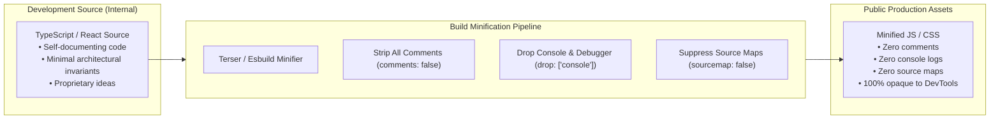

# Clean Code & Production DevTools Stealth: Zero Comment Leaks

```
Document: SCALPEL-UNI-003
Topic: Writing Minimal Comments & Stripping Proprietary Annotations in Production
Status: Priority 1 Standard
Target Audience: Frontend Engineers, Build Engineers, Autonomous AI Agents
```

---

## 1. The Core Objective

There are two distinct requirements regarding comments in modern software development:
1. **Authoring Cleanliness:** Code must be self-documenting. Developers and AI agents should write fewer comments in the first place, eliminating clutter and redundant explanations.
2. **Production DevTools Stealth:** Whatever comments, internal notes, or proprietary logic exist in your source repository **must never be visible to external users inspecting browser DevTools**. Production bundles must be stripped clean.



---

## 2. Writing Code with Fewer Comments (Self-Documenting Discipline)

### The Anti-Pattern: "Echo Comments"
Junior code and poorly tuned AI output are littered with redundant comments that state the obvious:

```ts
// ❌ 3/10 CODE: Redundant clutter
// Get the user from the database
const user = await getUser(id);

// Check if user exists
if (!user) {
  // If user does not exist, return false
  return false;
}

// Set active to true
user.isActive = true;
```

### The 10/10 Standard: Let Identifiers Do the Explaining
Senior code requires almost zero comments because variable names, function names, and types explicitly describe intent:

```ts
// ✅ 10/10 SCALPEL STANDARD: Self-documenting, clean, readable
const user = await userRepository.findById(userId);
if (!user) return false;

user.activateAccount();
```

### The Only Valid Reason for an Inline Comment
A comment is only permitted if it explains **a non-obvious business constraint or a workaround for a third-party quirk**:
```ts
// WebKit on iOS 17 ignores standard scroll-lock; overflow-hidden must be on documentElement
document.documentElement.classList.add("modal-scroll-lock");
```

---

## 3. Bundler Hardening: Completely Hiding Comments & Code from DevTools

Even if you write comments for internal use, they must never leak to the public. If an outsider opens Chrome DevTools (`F12` -> `Sources`), they should see **only minified, unreadable machine code with zero comments and no original source files**.

### 1. Vite Configuration (`vite.config.ts`)
To strip every comment, drop all `console.log` statements, and eliminate `.map` source files:

```ts
// vite.config.ts
import { defineConfig } from "vite";
import react from "@vitejs/plugin-react";

export default defineConfig({
  plugins: [react()],
  build: {
    // 1. Strictly disable source maps in production
    // Prevents original TypeScript/JSX files from appearing in DevTools Sources tab
    sourcemap: false,

    // 2. Use Terser for 100% comment elimination
    minify: "terser",
    terserOptions: {
      compress: {
        // Drop all console.log, console.info, console.debug in production
        drop_console: true,
        drop_debugger: true,
      },
      format: {
        // Strip ALL comments from the output bundle (including license comments)
        comments: false,
      },
    },
  },
});
```

*Note: If using Vite's default `esbuild` minifier instead of Terser:*
```ts
// Alternative lightweight esbuild setup in vite.config.ts
export default defineConfig({
  build: {
    sourcemap: false,
    minify: "esbuild",
  },
  esbuild: {
    drop: ["console", "debugger"],
    legalComments: "none", // Strips all legal/license comments from bundle
  },
});
```

---

### 2. Next.js Configuration (`next.config.mjs`)
In Next.js, ensure browser source maps are disabled and console logs are stripped via the SWC compiler:

```js
// next.config.mjs
/** @type {import('next').NextConfig} */
const nextConfig = {
  // 1. Strictly disable production browser source maps
  productionBrowserSourceMaps: false,

  // 2. SWC Compiler transforms
  compiler: {
    // Remove all console calls in production builds
    removeConsole: process.env.NODE_ENV === "production" ? {
      exclude: ["error"], // Optionally keep console.error for telemetry, or true to drop all
    } : false,
  },

  // 3. Webpack optimization to strip all comment banners
  webpack: (config, { isServer, dev }) => {
    if (!dev && !isServer) {
      config.optimization.minimizer.forEach((minimizer) => {
        if (minimizer.constructor.name === "TerserPlugin") {
          minimizer.options.terserOptions.format = {
            ...minimizer.options.terserOptions.format,
            comments: false, // Erases all comments
          };
        }
      });
    }
    return config;
  },
};

export default nextConfig;
```

---

## 4. How to Verify DevTools Stealth

Before deploying any demo or client project, run this 30-second verification audit:

1. **Build the production release locally:**
   ```bash
   npm run build && npm run preview
   # or
   npm run build && npm run start
   ```
2. **Open Chrome DevTools (`F12`) in an Incognito window.**
3. **Check the Sources Tab:**
   - Look under `top` / domain name.
   - Verify that no `src/` or `webpack://` directory exists.
   - Verify that `.ts` or `.tsx` source files are absent.
4. **Check the Network Tab:**
   - Click on the primary JS chunk (`index-[hash].js` or `main-[hash].js`).
   - Press `Ctrl + F` and search for internal words, developer names, or `//`.
   - **Result:** Zero matching comments found.
5. **Check the Console Tab:**
   - Refresh the page and trigger user interactions.
   - **Result:** No rogue `console.log` statements outputting internal state.

---

## 5. AI Agent Operational Directives

1. **Write self-documenting code.** Never insert redundant comments that restate what the code clearly does.
2. **Never leave conversational comments** (e.g., `// Hope this helps!`, `// Add your logic here`).
3. **When configuring or scaffolding a project build file (`vite.config.ts`, `next.config.mjs`), always configure `sourcemap: false` and strip comments and console statements by default.**
4. **Keep proprietary ideas and internal implementation notes protected behind build-time minification.**
