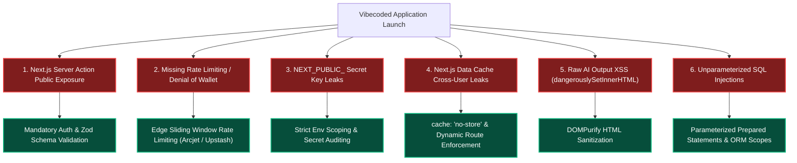

# Security Defenses for Fast-Paced ("Vibecoded") Stacks

```
Document: SCALPEL-SEC-001
Topic: Hardening AI-Generated & Fast-Iterated Web Applications
Status: Priority 1 Standard
Target Audience: Full-Stack Engineers, Security Leads, Autonomous AI Agents
```

---

## 1. The "Vibecoding" Security Crisis

Modern development with AI coding agents (Cursor, v0, Lovable, Claude Code) allows developers to build functional, visually stunning web applications in hours. 

However, AI models optimize for **immediate visual functionality and compiler satisfaction**, not **threat models**. As a result, 90% of rapidly generated "vibecoded" websites contain catastrophic vulnerabilities waiting to be exploited within minutes of hitting a public domain:



---

## 2. Vulnerability 1: The Server Action "Public Endpoint" Trap

### The Flaw
Vibecoded Next.js apps rely heavily on `"use server"` Server Actions. Developers think of them as internal functions called by React buttons. **They are not.** Next.js compiles every Server Action into a **publicly callable HTTP POST endpoint**.

Anyone inspecting DevTools can grab the action ID and invoke it directly with modified JSON payloads—bypassing any UI checks.

```ts
// ❌ 3/10 VIBECODED DISASTER: Anyone on the internet can delete any organization!
"use server";
import { db } from "@/lib/db";

export async function deleteOrganization(orgId: string) {
  // NO SESSION CHECK, NO PERMISSION CHECK!
  await db.organization.delete({ where: { id: orgId } });
}
```

### The 10/10 SCALPEL Defense
Every Server Action and API route must enforce **Authentication, Authorization, and Input Schema Parsing** at the very top of the function:

```ts
// ✅ 10/10 SCALPEL DEFENSE: Bulletproof Server Action
"use server";

import { z } from "zod";
import { getSession } from "@/lib/auth";
import { db } from "@/lib/db";

const DeleteOrgSchema = z.object({
  orgId: z.string().uuid("Invalid organization ID format"),
});

export async function deleteOrganization(rawInput: unknown) {
  // 1. Authenticate
  const session = await getSession();
  if (!session?.user?.id) {
    throw new Error("UNAUTHORIZED");
  }

  // 2. Validate input schema
  const parseResult = DeleteOrgSchema.safeParse(rawInput);
  if (!parseResult.success) {
    throw new Error("INVALID_PAYLOAD");
  }
  const { orgId } = parseResult.data;

  // 3. Authorize (Verify the user is an OWNER of THIS organization)
  const membership = await db.membership.findFirst({
    where: {
      organizationId: orgId,
      userId: session.user.id,
      role: "OWNER",
    },
  });

  if (!membership) {
    throw new Error("FORBIDDEN: You do not own this organization");
  }

  // 4. Execute atomic deletion
  await db.organization.delete({ where: { id: orgId } });
  return { success: true };
}
```

---

## 3. Vulnerability 2: Missing Rate Limiting & "Denial of Wallet"

### The Flaw
When vibecoded demo sites integrate LLM features (OpenAI, Anthropic) or send transactional emails (Resend), they rarely throttle incoming requests.
* A single attacker running a simple bash loop (`for i in {1..10000}; do curl -X POST ...`) will drain your API balance in 10 minutes, generating thousands of dollars in cloud bills ("Denial of Wallet").
* Login and OTP verification endpoints get hit with brute-force credential stuffing.

### The 10/10 SCALPEL Defense
Implement edge-level sliding window rate limiting on all public mutations:

```ts
// lib/rate-limit.ts
import { Ratelimit } from "@upstash/ratelimit";
import { Redis } from "@upstash/redis";

const redis = Redis.fromEnv();

// Strict limiter for expensive AI / mutation endpoints: 5 requests per 60 seconds
export const aiRateLimiter = new Ratelimit({
  redis,
  limiter: Ratelimit.slidingWindow(5, "60 s"),
  analytics: true,
  prefix: "ratelimit:ai",
});
```

```ts
// app/api/generate/route.ts
import { NextRequest, NextResponse } from "next/server";
import { aiRateLimiter } from "@/lib/rate-limit";

export async function POST(req: NextRequest) {
  // Extract client IP or authenticated User ID
  const ip = req.headers.get("x-forwarded-for")?.split(",")[0] ?? "127.0.0.1";
  
  const { success, limit, remaining, reset } = await aiRateLimiter.limit(ip);

  if (!success) {
    return NextResponse.json(
      { error: "Too many requests. Please wait before generating again." },
      { 
        status: 429, 
        headers: {
          "Retry-After": Math.ceil((reset - Date.now()) / 1000).toString(),
          "X-RateLimit-Limit": limit.toString(),
          "X-RateLimit-Remaining": remaining.toString(),
        } 
      }
    );
  }

  // Proceed with processing
}
```

---

## 4. Vulnerability 3: The `NEXT_PUBLIC_` Secret Leak

### The Flaw
When an AI agent struggles with a server/client database call, it frequently renames environment variables to `NEXT_PUBLIC_SUPABASE_SERVICE_ROLE_KEY` or `NEXT_PUBLIC_STRIPE_SECRET_KEY` to resolve build errors.

Prefixing a secret with `NEXT_PUBLIC_` (or `VITE_` in Vite) bundles that secret directly into plain-text client JavaScript. Anyone can open DevTools, inspect `main.js`, and steal admin database credentials.

### The 10/10 SCALPEL Defense
1. **Never prefix administrative keys with public flags:**
   - ❌ `NEXT_PUBLIC_SERVICE_ROLE_KEY` (Exposed to the entire internet)
   - ✅ `SUPABASE_SERVICE_ROLE_KEY` (Server-side only)
2. **Enforce `server-only` guards:**
   In Next.js, import `server-only` in files holding private keys to cause an immediate compile error if any client file attempts to import it:
   ```ts
   // lib/supabase-admin.ts
   import "server-only";
   import { createClient } from "@supabase/supabase-js";

   export const adminClient = createClient(
     process.env.SUPABASE_URL!,
     process.env.SUPABASE_SERVICE_ROLE_KEY! // Guaranteed never to leak to client
   );
   ```

---

## 5. Vulnerability 4: Cross-User Data Leaks via Aggressive Next.js Caching

### The Flaw
Next.js App Router aggressively caches `fetch` calls by default in its Data Cache. If you fetch user profile data without explicitly specifying dynamic options:
```ts
// ❌ 3/10 DISASTER: Cached at the server level!
// User B requests their dashboard and sees User A's private banking data!
const res = await fetch(`https://api.internal.com/user/profile`);
```

### The 10/10 SCALPEL Defense
For any authenticated or personalized data, **disable the data cache completely**:
```ts
// ✅ 10/10 SCALPEL DEFENSE: Strict per-request execution
const res = await fetch(`https://api.internal.com/user/profile`, {
  cache: "no-store", // Never cache private user data across requests
  headers: {
    Authorization: `Bearer ${userToken}`,
  },
});
```
Or force dynamic rendering at the page level:
```ts
export const dynamic = "force-dynamic";
```

---

## 6. Vulnerability 5: XSS in Markdown & AI Output

### The Flaw
Vibecoded sites displaying AI responses or user comments often feed strings directly into `dangerouslySetInnerHTML`:
```tsx
// ❌ 3/10 DISASTER: Allows malicious scripts to steal session tokens
<div dangerouslySetInnerHTML={{ __html: aiResponse }} />
```

### The 10/10 SCALPEL Defense
Always sanitize HTML through **DOMPurify** (with `isomorphic-dompurify` for SSR support):

```tsx
// ✅ 10/10 SCALPEL DEFENSE: Sanitized Output
import DOMPurify from "isomorphic-dompurify";

interface SafeHTMLProps {
  content: string;
}

export function SafeHTML({ content }: SafeHTMLProps) {
  const cleanHTML = DOMPurify.sanitize(content, {
    ALLOWED_TAGS: ["b", "i", "em", "strong", "a", "p", "ul", "ol", "li", "code", "pre"],
    ALLOWED_ATTR: ["href", "target", "rel"],
  });

  return <div dangerouslySetInnerHTML={{ __html: cleanHTML }} />;
}
```

---

## 7. Vulnerability 6: SQL Injection via Raw Template Literals

### The Flaw
Concatenating raw strings into SQL queries:
```ts
// ❌ 3/10 DISASTER: SQL Injection
const query = `SELECT * FROM users WHERE email = '${req.body.email}'`;
```

### The 10/10 SCALPEL Defense
Always use parameterized SQL queries or type-safe query builders:
```ts
// ✅ 10/10 SCALPEL DEFENSE: Parameterized Query
const user = await sql`
  SELECT id, email, created_at 
  FROM users 
  WHERE email = ${email}
`;
```

---

## 8. AI Agent Security Directives

1. **Every Server Action or API mutation must validate input using a Zod schema.**
2. **Never expose administrative database tokens or third-party secret keys with `NEXT_PUBLIC_` or `VITE_` prefixes.**
3. **Always apply rate limiting to authentication, email, and LLM API endpoints.**
4. **Never render untrusted markup via `dangerouslySetInnerHTML` without passing it through `DOMPurify.sanitize()`.**
5. **Always add `cache: 'no-store'` or `export const dynamic = 'force-dynamic'` to routes serving personalized user data.**
