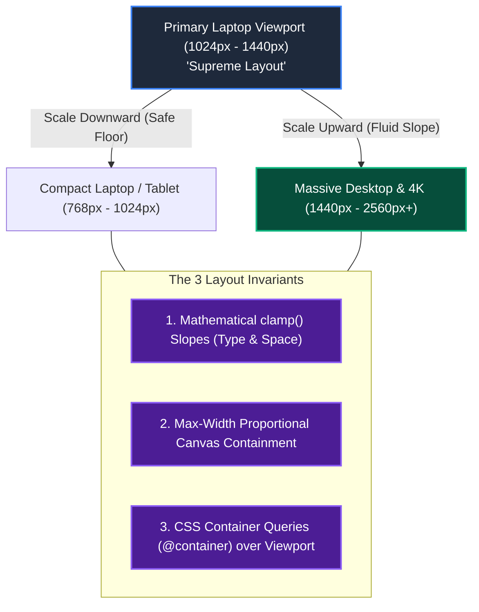

# Design-First Responsive Scaling: Preserving the Supreme Laptop Layout

```
Document: SCALPEL-FE-001
Topic: Design-First Layout Integrity & Fluid Scaling (Laptop to 4K Displays)
Status: Priority 1 Standard
Target Audience: UI/UX Designers, Frontend Engineers, AI Coding Agents
```

---

## 1. The Core Problem: "It Looks Perfect on My Laptop, Broken on Everything Else"

In design-driven development (e.g., **Envy Studio**), websites are crafted with high aesthetic fidelity on a designer’s primary machine—typically a **laptop** (13", 14", or 16" MacBook / Windows laptop, typically rendering at `1366x768`, `1440x900`, `1536x864`, or `1920x1080`).

When this layout is viewed on a collaborator's **massive screen** (27" 1440p, 32" 4K, or 34" Ultrawide), standard naive CSS breaks down completely:
* Typography stays microscopic while containers stretch into awkward, empty expanses.
* Elements wrap unexpectedly, pushing carefully aligned buttons and badges below the fold.
* Absolute or fixed positions drift, causing overlapping text and clipped graphics.
* Or conversely, on smaller laptop screens, text wraps prematurely, cutting off hero titles or breaking grid columns.

### The SCALPEL Law of Layout Supremacy
> **The designer's laptop layout is the Supreme Ground Truth.**  
> It must never stretch into distortion on 4K, nor crunch and overlap on smaller screens. The AI agent must build responsive scaling defensively by default—without requiring the user to prompt *"don't break this"* repeatedly.

---

## 2. Why Conventional Approaches Fail

| Method | How it Works | Why It Fails Modern Design-First Workflows |
| :--- | :--- | :--- |
| **Fixed Pixels (`px`)** | Rigid pixel widths (`width: 1200px`) | Breaks immediately on screens narrower than the pixel width; looks tiny and isolated on 4K monitors. |
| **Naive Percentages (`%`)** | Fluid widths (`width: 80%`) | Stretches infinitely on ultra-wide screens, blowing apart carefully tuned typographic line lengths and visual hierarchy. |
| **Media Query Explosion** | Writing `@media` for every 200px jump | Jumpy, jarring transitions. Elements snap suddenly. Maintenance nightmare across 15 breakpoints. |
| **Naive Viewport Units (`vw`/`vh`)** | `font-size: 3vw` | Uncontrolled extremes. Text becomes microscopic on small laptops and cartoonishly oversized on 4K monitors. Breaks accessibility zoom. |

---

## 3. The 10/10 Solution: The SCALPEL Fluid Scaling Architecture

To maintain the exact proportions of the laptop layout across all screens without awkward snapping, we implement a **three-tier layout defense**:



---

## 4. Mathematical Fluid Scaling with CSS `clamp()`

Instead of rigid jumps, dimensions scale smoothly using a linear slope between a defined minimum viewport (small laptop) and maximum viewport (4K desktop).

### The Universal Slope Formula
To scale any property from `minValue` at `minViewport` to `maxValue` at `maxViewport`:

$$\text{Slope} = \frac{\text{maxValue} - \text{minValue}}{\text{maxViewport} - \text{minViewport}}$$

$$\text{Intersection} = \text{minValue} - (\text{Slope} \times \text{minViewport})$$

$$\text{CSS Value} = \text{clamp}(\text{minValue}, \text{Intersection} + (\text{Slope} \times 100)\text{vw}, \text{maxValue})$$

### Pre-Calculated Design Tokens (Laptop to 4K Master Scale)

```css
:root {
  /* ==========================================================================
     VIEWPORT BOUNDARIES:
     Min: 1024px (Small Laptop / Compact Display)
     Max: 2560px (4K / Large Ultrawide Monitor)
     ========================================================================== */

  /* Fluid Typography Tokens (Always includes rem base for accessibility) */
  --font-xs:   clamp(0.75rem,  0.71rem + 0.16vw, 0.90rem);
  --font-sm:   clamp(0.875rem, 0.81rem + 0.26vw, 1.125rem);
  --font-base: clamp(1.00rem,  0.92rem + 0.39vw, 1.375rem);
  --font-lg:   clamp(1.25rem,  1.12rem + 0.65vw, 1.875rem);
  --font-xl:   clamp(1.50rem,  1.29rem + 1.04vw, 2.50rem);
  --font-2xl:  clamp(2.00rem,  1.67rem + 1.56vw, 3.50rem);
  --font-hero: clamp(2.75rem,  2.16rem + 2.73vw, 5.50rem);

  /* Fluid Spacing & Padding Tokens */
  --space-3xs: clamp(0.25rem, 0.21rem + 0.16vw, 0.40rem);
  --space-2xs: clamp(0.50rem, 0.45rem + 0.26vw, 0.75rem);
  --space-xs:  clamp(0.75rem, 0.67rem + 0.39vw, 1.125rem);
  --space-sm:  clamp(1.00rem, 0.89rem + 0.52vw, 1.50rem);
  --space-md:  clamp(1.50rem, 1.29rem + 1.04vw, 2.50rem);
  --space-lg:  clamp(2.00rem, 1.69rem + 1.56vw, 3.50rem);
  --space-xl:  clamp(3.00rem, 2.48rem + 2.60vw, 5.50rem);
  --space-2xl: clamp(4.00rem, 3.27rem + 3.65vw, 7.50rem);

  /* Section Padding */
  --section-px: clamp(1.25rem, 0.83rem + 2.08vw, 3.25rem);
  --section-py: clamp(2.50rem, 1.88rem + 3.13vw, 5.50rem);

  /* Proportional Canvas Width */
  --canvas-max-width: 1800px;
}
```

---

## 5. Preventing 4K Stretch: The Proportional Canvas Technique

On a massive 32" 4K monitor (e.g., your friend's setup), a layout must not stretch edge-to-edge into empty space unless explicitly intended as a full-bleed backdrop.

### Implementation: The Supreme Canvas Wrapper
Every desktop-first layout must wrap content inside a constrained canvas that scales gracefully up to a ceiling, then centers cleanly:

```html
<!-- index.html / App Shell -->
<div class="supreme-viewport">
  <main class="supreme-canvas">
    <!-- All designer content lives here -->
  </main>
</div>
```

```css
/* Layout Shell */
.supreme-viewport {
  width: 100%;
  min-height: 100vh;
  display: flex;
  flex-direction: column;
  align-items: center;
  background-color: var(--bg-surface, #0d0f12);
  overflow-x: hidden; /* Strict defense against rogue horizontal scrollbars */
}

.supreme-canvas {
  width: 100%;
  max-width: var(--canvas-max-width, 1800px);
  margin-left: auto;
  margin-right: auto;
  padding-left: var(--section-px);
  padding-right: var(--section-px);
  box-sizing: border-box;
  position: relative;
}
```

### Why This Fixes the Two-Designer Disparity
* **On your laptop (1440px):** The canvas fills the screen comfortably (`100%` width with proportional padding). Every font and gap matches your exact eye-level design.
* **On your friend's huge 4K screen (2560px+):** The content scales up proportionally via `clamp()`, and caps at `1800px`, perfectly centered with elegant negative space margins. It never feels "sparse" or "broken."

---

## 6. Defensive Rules: "Don't Break My Layout"

AI coding agents frequently break layouts because they omit defensive CSS properties. Under SCALPEL, every AI agent must apply these 5 defensive rules automatically:

### Rule 1: Guard Against Flex-Shrink Collapses
When elements share a row, text elements or icons can crunch and squeeze into illegible slivers on smaller screens.
```css
/* BAD: AI forgets flex-shrink */
.badge-icon {
  width: 24px;
  height: 24px;
}

/* 10/10 SCALPEL DEFENSE */
.badge-icon {
  width: 24px;
  height: 24px;
  flex-shrink: 0; /* Never allow flex parents to crush icons or fixed tags */
}
```

### Rule 2: Prevent Text Overflow and Premature Line Breaks
Hero headings and badges must not wrap unpredictably:
```css
.hero-tag {
  white-space: nowrap; /* Keeps pills and badges single-line */
  overflow: hidden;
  text-overflow: ellipsis;
}

.hero-title {
  text-wrap: balance; /* Modern CSS: balances headline wraps aesthetically */
}
```

### Rule 3: Use Container Queries Instead of Viewport Queries
When a component is placed in a 2-column or 3-column layout, its width is governed by its **parent container**, not the user's entire monitor.
```css
/* Parent Card Wrapper */
.card-wrapper {
  container-type: inline-size;
  container-name: card;
}

/* Child changes layout based on ITS OWN available width, not screen width */
@container card (max-width: 400px) {
  .card-inner {
    flex-direction: column;
  }
}
```

### Rule 4: Rigid Column Templates with `minmax`
Never write arbitrary pixel columns without a minimum threshold:
```css
/* BAD: Breaks when screen shrinks */
.dashboard-grid {
  display: grid;
  grid-template-columns: 350px 1fr 300px;
}

/* 10/10 SCALPEL DEFENSE: Adapts smoothly */
.dashboard-grid {
  display: grid;
  grid-template-columns: minmax(280px, 350px) 1fr minmax(240px, 300px);
  gap: var(--space-md);
}
```

### Rule 5: Aspect Ratio Shields for Media
Images and video cards must maintain their geometric proportion so layout shifts (CLS) never occur:
```css
.card-media-shield {
  width: 100%;
  aspect-ratio: 16 / 9;
  object-fit: cover;
  border-radius: var(--radius-md, 8px);
}
```

---

## 7. AI Agent Operational Directive

When generating or editing any frontend component or page layout:
1. **Never use static `px` values for typography, section padding, or gaps.** Always use the fluid design tokens (`var(--font-*)`, `var(--space-*)`).
2. **Never allow unconstrained full-width text.** Hero paragraphs must be capped with `max-width: 65ch` or contained within the `.supreme-canvas`.
3. **Always set `overflow-x: hidden` on viewport roots** to eliminate accidental horizontal scrolling.
4. **Always set `flex-shrink: 0` on icons, avatars, and fixed controls.**
5. **Never question the designer's choice of font, color palette, or border treatment.** Execute the visual aesthetic with 100% fidelity using mathematical fluid scaling.
