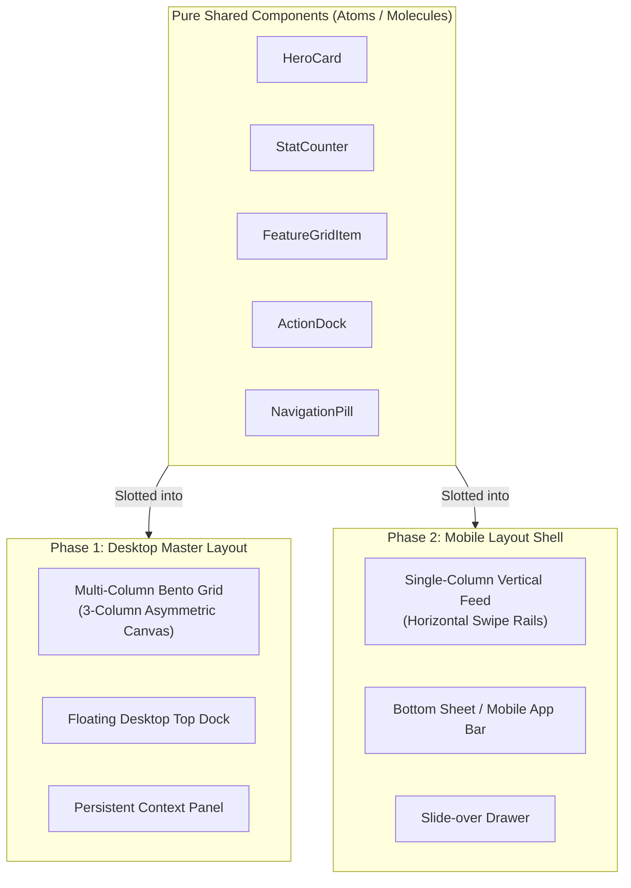

# Desktop-First, Mobile-Later: Shared Components with Decoupled Layouts

```
Document: SCALPEL-FE-002
Topic: Desktop-First Development & Layout-Component Decoupling
Status: Priority 1 Standard
Target Audience: UI/UX Designers, Frontend Engineers, AI Coding Agents
```

---

## 1. The Strategy: Desktop-First without Compromise

Many web development tutorials preach "Mobile-First." For design-driven projects (like **Envy Studio**), **Mobile-First is often the wrong tool**.

When a designer sits down at a laptop to create an expansive, striking visual demo, the desktop layout is the centerpiece. Trying to think in mobile columns first neuters creative layout ambition.

Under SCALPEL:
1. **Desktop is developed first with absolute aesthetic priority.**
2. **Mobile is developed later with equal visual polish.**
3. **Crucially: Desktop and Mobile share the exact same UI components, but use decoupled layout orchestrators.**



---

## 2. The Anti-Pattern: Component Pollution with `isMobile` Props

The standard junior/mid-level mistake is cluttering shared components with device-specific conditionals:

```tsx
// ❌ 3/10 ANTI-PATTERN: Polluting components with layout & device props
export function FeatureCard({ isMobile, hideOnDesktop, mobilePadding }: CardProps) {
  return (
    <div className={`card ${isMobile ? 'p-2 flex-col' : 'p-8 flex-row'}`}>
      <h3 className={isMobile ? 'text-sm' : 'text-2xl'}>Title</h3>
      {!isMobile && <p>Detailed desktop explanation...</p>}
    </div>
  );
}
```

### Why This Fails:
* Every time a new screen size is touched, every component file must be re-edited.
* Testing becomes combinatorial chaos (testing with `isMobile=true`, `isMobile=false`).
* Destroys the desktop design fidelity by introducing accidental regression bugs.

---

## 3. The 10/10 Architecture: Decoupling Components from Layout

### Principle 1: Components Never Dictate External Geometry
A shared component (e.g., `<StatCard />`, `<HeroMedia />`) must be **layout-agnostic**:
* **No outer margins:** A component never sets `margin: 2rem` on its root. Outer spacing belongs to the parent layout grid or flex container.
* **No fixed page positioning:** A component never declares `position: fixed; top: 20px` unless it is explicitly an overlay primitive (like a modal).
* **Width is `100%` of container:** The component fills whatever slot the parent layout gives it.

```tsx
// ✅ 10/10 SCALPEL STANDARD: Pure Shared Component
// file: src/components/cards/StatCard.tsx
interface StatCardProps {
  label: string;
  value: string;
  change: string;
  trend: 'up' | 'down';
}

export function StatCard({ label, value, change, trend }: StatCardProps) {
  return (
    <article className="stat-card">
      <span className="stat-label">{label}</span>
      <div className="stat-value-row">
        <strong className="stat-value">{value}</strong>
        <span className={`stat-badge stat-badge--${trend}`}>{change}</span>
      </div>
    </article>
  );
}
```

```css
/* Component-scoped CSS: Internal padding and typography ONLY */
.stat-card {
  width: 100%;
  padding: var(--space-md);
  border-radius: var(--radius-lg, 12px);
  background: var(--surface-card, #14171c);
  border: 1px solid var(--border-subtle, rgba(255, 255, 255, 0.08));
  display: flex;
  flex-direction: column;
  gap: var(--space-xs);
  box-sizing: border-box;
}

.stat-label {
  font-size: var(--font-xs);
  color: var(--text-muted, #8b949e);
  text-transform: uppercase;
  letter-spacing: 0.05em;
}

.stat-value {
  font-size: var(--font-xl);
  font-weight: 700;
  color: var(--text-primary, #ffffff);
}
```

---

## 4. Phase 1: Building the Desktop Master Layout (Priority 1)

During Phase 1, focus 100% on crafting the desktop layout. Do not worry about mobile queries until the desktop aesthetic is locked.

```tsx
// file: src/layouts/AnalyticsDesktopLayout.tsx
import { StatCard } from '@/components/cards/StatCard';
import { ChartModule } from '@/components/charts/ChartModule';
import { ActivityFeed } from '@/components/feed/ActivityFeed';

export function AnalyticsDesktopLayout() {
  return (
    <div className="analytics-desktop-grid">
      {/* Column 1 & 2: Top KPI Row */}
      <section className="grid-area-kpis">
        <StatCard label="Total Revenue" value="$84,230" change="+14.2%" trend="up" />
        <StatCard label="Active Sessions" value="12,450" change="+4.1%" trend="up" />
        <StatCard label="Churn Rate" value="1.08%" change="-0.4%" trend="down" />
      </section>

      {/* Main Interactive Chart */}
      <section className="grid-area-chart">
        <ChartModule />
      </section>

      {/* Persistent Side Activity Panel */}
      <aside className="grid-area-feed">
        <ActivityFeed />
      </aside>
    </div>
  );
}
```

```css
/* file: src/layouts/AnalyticsDesktopLayout.css */
.analytics-desktop-grid {
  display: grid;
  grid-template-columns: minmax(0, 1fr) minmax(0, 1fr) 360px;
  grid-template-rows: auto 1fr;
  grid-template-areas:
    "kpis  kpis  feed"
    "chart chart feed";
  gap: var(--space-md);
  width: 100%;
  min-height: calc(100vh - 120px);
}

.grid-area-kpis {
  grid-area: kpis;
  display: grid;
  grid-template-columns: repeat(3, minmax(0, 1fr));
  gap: var(--space-md);
}

.grid-area-chart {
  grid-area: chart;
  min-height: 480px;
}

.grid-area-feed {
  grid-area: feed;
  max-height: 800px;
  overflow-y: auto;
}
```

---

## 5. Phase 2: Slotting into the Mobile Layout (Later Phase)

When the desktop design is finalized, mobile is implemented by simply creating the mobile layout orchestrator. **The shared components (`StatCard`, `ChartModule`, `ActivityFeed`) are not touched or edited**:

```tsx
// file: src/layouts/AnalyticsMobileLayout.tsx
import { StatCard } from '@/components/cards/StatCard';
import { ChartModule } from '@/components/charts/ChartModule';
import { ActivityFeed } from '@/components/feed/ActivityFeed';

export function AnalyticsMobileLayout() {
  return (
    <div className="analytics-mobile-stack">
      {/* Horizontal Swipe Rail for KPIs on Mobile */}
      <section className="mobile-kpi-rail">
        <div className="mobile-kpi-rail__track">
          <StatCard label="Revenue" value="$84.2k" change="+14%" trend="up" />
          <StatCard label="Active" value="12.4k" change="+4%" trend="up" />
          <StatCard label="Churn" value="1.08%" change="-0.4%" trend="down" />
        </div>
      </section>

      {/* Stacked Chart */}
      <section className="mobile-chart-card">
        <ChartModule compact />
      </section>

      {/* Collapsible Mobile Drawer or Stacked Feed */}
      <section className="mobile-feed-section">
        <ActivityFeed />
      </section>
    </div>
  );
}
```

```css
/* file: src/layouts/AnalyticsMobileLayout.css */
.analytics-mobile-stack {
  display: flex;
  flex-direction: column;
  gap: var(--space-md);
  width: 100%;
  padding-bottom: 80px; /* Space for mobile nav dock */
}

/* Smooth Horizontal Carousel without Scrollbars */
.mobile-kpi-rail {
  width: 100vw;
  margin-left: calc(-1 * var(--section-px));
  margin-right: calc(-1 * var(--section-px));
  overflow-x: auto;
  scrollbar-width: none;
  -webkit-overflow-scrolling: touch;
}

.mobile-kpi-rail::-webkit-scrollbar {
  display: none;
}

.mobile-kpi-rail__track {
  display: flex;
  gap: var(--space-sm);
  padding: 0 var(--section-px);
  width: max-content;
}

.mobile-kpi-rail__track > * {
  width: 240px; /* Comfortable card swipe width */
  flex-shrink: 0;
}
```

---

## 6. How to Switch Layouts Cleanly in the Page Route

Instead of relying on fragile JavaScript window resize listeners, leverage CSS media display switches or modern SSR route branching:

```tsx
// file: src/pages/AnalyticsPage.tsx
import { AnalyticsDesktopLayout } from '@/layouts/AnalyticsDesktopLayout';
import { AnalyticsMobileLayout } from '@/layouts/AnalyticsMobileLayout';

export default function AnalyticsPage() {
  return (
    <div className="analytics-page-root">
      {/* Desktop view: hidden below 1024px */}
      <div className="layout-desktop-only">
        <AnalyticsDesktopLayout />
      </div>

      {/* Mobile view: hidden at or above 1024px */}
      <div className="layout-mobile-only">
        <AnalyticsMobileLayout />
      </div>
    </div>
  );
}
```

```css
.layout-desktop-only {
  display: block;
}

.layout-mobile-only {
  display: none;
}

@media (max-width: 1023px) {
  .layout-desktop-only {
    display: none;
  }
  .layout-mobile-only {
    display: block;
  }
}
```

---

## 7. AI Agent Operational Directives

1. **Never alter shared component markup to solve a layout problem.** If a card doesn't fit on mobile or desktop, adjust the layout grid container, not the card.
2. **Never add `isMobile` boolean flags to base atomic components.** Components must respond to their container width via `@container` or flex/grid slot allocation.
3. **During Phase 1 (Desktop First):** Ignore mobile breakpoints until the desktop layout matches the designer's laptop vision 1:1.
4. **Never remove elements from the desktop layout when adding mobile support.** Desktop fidelity is sacred and permanent.
