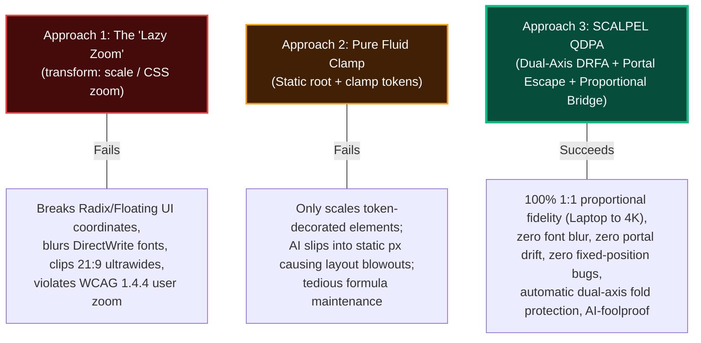
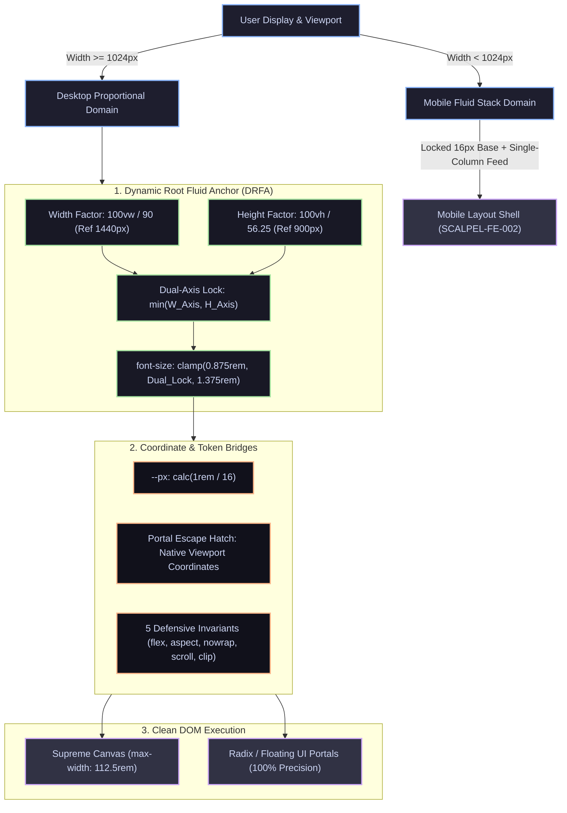

# Quantum Dynamic Proportional Architecture (QDPA): The Definitive Scaling Standard

```
Document: SCALPEL-FE-003
Topic: Universal Resolution Independence, Dual-Axis Fluid Anchoring & Portal-Safe Proportional Scaling (Laptop to 4K Ultrawide)
Status: Priority 1 Standard
Target Audience: UI/UX Designers, Frontend Architects, AI Coding Agents
Supersedes/Extends: SCALPEL-FE-001, SCALPEL-FE-002
```

---

## 1. Executive Summary: Solving the Visual Scaling Trilemma

Modern high-fidelity web design—epitomized by **Envy Studio** and modern dashboard/SaaS applications—is conceived on a designer's laptop (typically a 14" to 16" display rendering at logical viewports of `1366x768`, `1440x900`, `1512x982`, or `1920x1080`).

When this layout is rendered across other environments, conventional frontend engineering confronts **The Visual Scaling Trilemma**:



### The Three Approaches Compared

| Dimension | Approach 1: The "Lazy Zoom" (`transform: scale()` / `zoom`) | Approach 2: Pure Fluid Tokens (`clamp()` tokens only) | Approach 3: SCALPEL QDPA (Master Standard) |
| :--- | :--- | :--- | :--- |
| **Proportional Fidelity (1024px to 4K)** | **10/10**: Entire canvas scales uniformly. | **6/10**: Only elements with tokens scale; static widths snap or stay rigid. | **10/10**: Entire DOM scales proportionally via dynamic root rem anchor. |
| **Portal & Dropdown Positioning** | ❌ **0/10 (FATAL)**: Floating UI/Radix drift by 50px–300px; double-scale bugs. | ✅ **10/10**: Native viewport coordinates intact. | ✅ **10/10**: Native viewport coordinates intact; zero transform distortion. |
| **`position: fixed` Overlays & Modals** | ❌ **0/10 (FATAL)**: Trapped inside ancestor containing block; scrolls away. | ✅ **10/10**: Anchored to screen viewport. | ✅ **10/10**: Anchored directly to screen viewport. |
| **Text Crispness & Subpixel Antialiasing** | ❌ **1/10 (BLURRY)**: Disables ClearType/DirectWrite; GPU bilinear blur. | ✅ **10/10**: Native subpixel vector rasterization. | ✅ **10/10**: Native subpixel vector rasterization at target physical DPI. |
| **Vertical Aspect Ratio & Ultrawide Safety** | ❌ **1/10 (CLIPPED)**: Crops bottom of page on short laptops; massive pillarbox on 21:9. | ⚠️ **5/10**: Requires manual vertical media queries for every component. | ✅ **10/10**: Dual-axis safety lock `min(W, H)` prevents fold blowout automatically. |
| **WCAG 1.4.4 (200% Browser Zoom)** | ❌ **0/10 (VIOLATION)**: Inverts user zoom (shrinks UI when user zooms in). | ✅ **10/10**: Fully compliant. | ✅ **10/10**: Disengages proportional lock below 1024px into reflow shell. |
| **AI Coding Agent Ergonomics** | ⚠️ **4/10**: AI writes broken fixed overlays and matrix transforms. | ❌ **3/10**: AI constantly hallucinates static `px` and forgets clamp tokens. | ✅ **10/10**: Standard Tailwind classes (`w-64`, `p-6`) scale automatically via rem! |

---

## 2. Anatomy of the "Lazy Zoom" & Its Fatal Engine Flaws

The "Lazy Zoom" or "Matrix Scale" trick wraps an application inside a fixed container (e.g., `1440x900` or `1920x1080`) and scales it via CSS:
```css
/* Naive Lazy Zoom Wrapper */
.viewport-wrapper {
  width: 100vw;
  height: 100vh;
  overflow: hidden;
}
.design-canvas {
  width: 1440px;
  height: 900px;
  transform-origin: top left;
  transform: scale(calc(100vw / 1440)); /* Or JS-driven window.innerWidth / 1440 */
}
```
While visually seductive in static screenshots, this trick causes **catastrophic breakdowns** across modern browser rendering engines (Chromium/Blink, Gecko, WebKit).

### 2.1 The Stacking Context & Containing Block Trap
The root cause is codified in the **W3C CSS Transforms Module Level 1 Specification (§3.1)**:
> *"For elements whose layout is governed by the CSS box model, any value other than none for the transform property also causes the element to **establish a containing block for all descendants**, including those that have `position: fixed` or `position: absolute`."*

Normally, per CSS 2.1 (§10.1), `position: fixed` elements anchor to the **initial containing block (the browser viewport)**. 
When placed inside a transformed container:
1. `position: fixed; inset: 0;` (e.g. modal backdrops, drawer overlays, top navigation bars) **no longer covers the screen**. It is trapped inside the transformed canvas box.
2. When the user scrolls, the "fixed" navbar scrolls away out of view.
3. If the container has `overflow: hidden`, fixed modals that exceed the container bounds are physically cropped in half.

### 2.2 The Broken Portal & Floating Coordinates Disaster
Modern UI primitives (Radix UI, Floating UI, Popper.js, Headless UI, React Aria) anchor dropdown menus, selects, popovers, and tooltips via JavaScript coordinate calculations:

```
[Screen Viewport: 1920px] ────────────────────────────────────────────────────────┐
│                                                                                 │
│   Scaled Container: transform: scale(0.75)                                      │
│   ┌────────────────────────────────────────────────────────┐                    │
│   │                                                        │                    │
│   │   Trigger Button (Local: 400px, 300px)                 │                    │
│   │   [ Open Dropdown ]                                    │                    │
│   └───────────┬────────────────────────────────────────────┘                    │
│               │                                                                 │
│               ▼ Floating UI measures button:                                    │
│                 rect.left = 400 * 0.75 = 300px                                  │
│                 rect.top  = 300 * 0.75 = 225px                                  │
│                                                                                 │
│   Scenario A: Portal mounted to document.body (Scale 1.0)                       │
│     Dropdown renders at full 100% scale next to a shrunken 75% button!          │
│     Typography and padding look cartoonishly giant; collision flips erratically.│
│                                                                                 │
│   Scenario B: Portal mounted INSIDE scaled container (The Double-Scale Trap)   │
│     Floating UI applies: transform: translate3d(300px, 225px, 0)                │
│     Browser Compositor multiplies by parent scale (0.75):                       │
│       Actual Screen X = 300 * 0.75 = 225px  (Drift: 75px LEFT!)                 │
│       Actual Screen Y = 225 * 0.75 = 168.75px (Drift: 56.25px UP!)              │
│     Result: Dropdown floats 100px away in thin air!                             │
└─────────────────────────────────────────────────────────────────────────────────┘
```

#### Documented Production Issues:
* **Radix UI Primitives #781 & #2331**: Popper content displaced and scroll jumping when trigger is inside transformed parent.
* **Floating UI #1584 & #1740**: Ancestor scale causes `getBoundingClientRect` coordinate desynchronization in `computePosition()`.
* **Popper.js #1197**: Floating elements offset by exact scale factor when ancestor has CSS transform.

### 2.3 Text Blurring & Subpixel Rendering Breakdown
1. **Compositor Promotion & Texture Scaling**:
   When `transform: scale()` is declared, Chromium (Blink/Skia) and WebKit promote the element to a composited GPU layer (`cc::PictureLayer`). To prevent constant layout reflow and memory re-allocations during animation, the browser rasterizes the layer into a GPU texture at its initial scale.
   On resize, the GPU stretches this bitmap texture using **bilinear interpolation (`GL_LINEAR`)**. Bilinear filtering acts as a low-pass blur filter, smearing crisp typography into a fuzzy haze.
2. **Death of Windows ClearType (Subpixel Antialiasing)**:
   High-contrast font legibility relies on LCD Subpixel Antialiasing (RGB subpixel striping via DirectWrite). This requires blending glyph edges directly into a known opaque background. Because transformed layers are treated as floating textures, **Blink, Gecko, and WebKit automatically strip LCD antialiasing on transformed layers**, downgrading to blurry grayscale antialiasing.
3. **The "Scale 0.5x with 2x Base" Workaround Fails**:
   Designing at 2x (`font-size: 32px`) and scaling by `0.5x` fails because:
   - Font hinting bytecode (TrueType delta hints) is non-linear. Downsampled 32px glyphs have improper stem weights and crushed counters compared to natively rasterized 16px glyphs.
   - Any odd-pixel padding or border (`15px * 0.5 = 7.5px`) knocks all descendants onto subpixel fractional coordinates, causing text shimmering and border dropouts.
   - Chromium Bug **40938563** & **41321934**: Non-integral scale and translation with transform causes permanent text blurring.

### 2.4 Vertical Cropping, Aspect Ratio Mismatch & Fold Cutoff
Designers design for a canonical 16:10 or 16:9 canvas (e.g. `1440x900` or `1920x1080`). But real displays diverge dramatically:
* **Ultrawide 21:9 Displays (`2560x1080`, `3440x1440`)**:
  Scaling solely by width ($\text{scale} = 2560 / 1440 \approx 1.77$):
  $$\text{Rendered Height} = 900\text{px} \times 1.77 = 1593\text{px}$$
  Available viewport height is only $\sim 920\text{px}$ (after browser toolbars).
  **Over 670 vertical pixels of content (footers, primary buttons, forms) are sliced off below the screen fold!**
* **Budget Laptops (`1366x768`)**:
  Browser tabs, address bar, bookmarks, and OS taskbar steal 150px–170px of vertical space, leaving only $\sim 600\text{px}$ of usable height. A width-scaled 1440px canvas crops $\sim 150\text{px}$ of content.
* **The "Fit to Screen" Letterbox Trap**:
  Scaling by `min(scaleW, scaleH)` on a 21:9 screen results in **over 35% of the screen wasted as black side letterboxes**, while body text shrinks to an unreadable 9px.

### 2.5 WCAG 1.4.4 Accessibility Inversion Paradox
Under WCAG 2.1/2.2 Success Criterion **1.4.4 (Resize Text - Level AA)**, text must resize up to 200% without loss of content or functionality.
When a user presses `Ctrl +` to zoom to 200%:
* The browser's CSS viewport shrinks by 50% ($1920\text{px} \to 960\text{px}$).
* Lazy Zoom calculates: $\text{scale} = 960 / 1920 = 0.5$.
* **The script actively shrinks the entire website to 50% to force-fit it!**
* The user asked for bigger text; the script made it smaller ($2.0 \times 0.5 = 1.0\times$ net).
* **This is an open-and-shut, immediate WCAG AA violation.**

---

## 3. The SCALPEL Solution: Quantum Dynamic Proportional Architecture (QDPA)

To eliminate all drawbacks of the Lazy Zoom while delivering **100% 1:1 proportional scaling** from laptop to 4K, SCALPEL introduces **QDPA**:



---

## 4. Deep Dive: The 4 Pillars of QDPA

### Pillar 1: Dual-Axis Dynamic Root Fluid Anchor (DRFA)

#### A. Reference Ground Truth
* **Reference Canvas Width ($W_{\text{ref}}$)**: `1440px` (The designer's laptop baseline).
* **Reference Canvas Height ($H_{\text{ref}}$)**: `900px` (Usable height on 16:10 / 16:9 displays).
* **Target Base Font Size ($S_{\text{base}}$)**: `16px` ($1\text{rem} = 16\text{px}$ at reference resolution).

#### B. Exact Mathematical Derivation of Divisors
1. **Width Divisor**:
   $$D_{\text{width}} = \frac{W_{\text{ref}}}{S_{\text{base}}} = \frac{1440\text{px}}{16\text{px}} = \mathbf{90} \implies \frac{100\text{vw}}{90} = 16\text{px at 1440px viewport}$$
2. **Height Divisor**:
   $$D_{\text{height}} = \frac{H_{\text{ref}}}{S_{\text{base}}} = \frac{900\text{px}}{16\text{px}} = \mathbf{56.25} \implies \frac{100\text{vh}}{56.25} = 16\text{px at 900px viewport}$$

#### C. The Dual-Axis Safety Lock
To eliminate vertical cropping on Ultrawide (21:9) and short laptop displays, the engine takes the **minimum of both axes**:
$$\text{Dual-Axis Factor} = \min\left(\frac{100\text{vw}}{90},\, \frac{100\text{vh}}{56.25}\right)$$

* **On a standard 1080p monitor ($1920 \times 1080$)**:
  - Width Factor: $\frac{1920}{90} = 21.33\text{px}$ ($1.333\times$).
  - Height Factor (with 160px toolbar overhead $\implies 920\text{px}$ height): $\frac{920}{56.25} = 16.35\text{px}$ ($1.022\times$).
  - $\min(21.33, 16.35) = \mathbf{16.35\text{px}}$.
  - **The layout automatically caps its vertical growth to fit the usable window height without pushing content below the fold!**
* **On a 34" Ultrawide monitor ($3440 \times 1440$, usable height $1280\text{px}$)**:
  - Width Factor: $\frac{3440}{90} = 38.22\text{px}$ (would blow out typography to giant proportions).
  - Height Factor: $\frac{1280}{56.25} = 22.75\text{px}$.
  - $\min(38.22, 22.75) = \mathbf{22.75\text{px}}$.
  - The height axis protects the layout from ultrawide ballooning, centering the proportional canvas elegantly!

#### D. The Master Bounded Formula
```css
@media (min-width: 1024px) {
  :root {
    --dpa-w-factor: calc(100vw / 90);
    --dpa-h-factor: calc(100vh / 56.25);
    --dpa-dual-axis: min(var(--dpa-w-factor), var(--dpa-h-factor));

    /* Clamped between 14px (0.875rem) and 22px (1.375rem) */
    font-size: clamp(0.875rem, var(--dpa-dual-axis), 1.375rem);
  }
}
```
* **Floor ($0.875\text{rem} \approx 14\text{px}$)**: Prevents text from shrinking below reading comfort on compact 1024px displays.
* **Ceiling ($1.375\text{rem} \approx 22\text{px}$)**: Prevents over-inflation on 4K/8K monitors, allowing the canvas to cap at `1800px` with balanced negative space.
* **WCAG 1.4.4 Proof**: $\frac{\text{Ceiling}}{\text{Floor}} = \frac{1.375\text{rem}}{0.875\text{rem}} \approx 1.57 \le 2.5$. Complies strictly with Maxwell Barvian's accessibility ceiling theorem!
* **User Zoom Handshake**: When the user zooms to 200% via `Ctrl +`, $W_{\text{viewport}}$ drops below 1024px, cleanly disengaging the proportional lock and entering the single-column reflow shell without horizontal scrollbars (WCAG 1.4.10 Reflow AA/AAA Pass).

---

### Pillar 2: Zero-Transform Coordinate Integrity & The Portal Escape Hatch

Because QDPA scales the root `font-size` rather than applying CSS `transform: scale()`, **the DOM coordinate system remains 100% native**:
1. **Zero Containing-Block Traps**: `position: fixed` modals, drawers, and toasts attach directly to the browser viewport.
2. **Pixel-Perfect Floating UI Coordinates**: `getBoundingClientRect()` returns exact viewport coordinates. Dropdowns, popovers, and tooltips snap to trigger buttons with subpixel accuracy.
3. **Harmonious Content Scaling**: Portals mounted at `document.body` inherit the root `rem` scaling automatically:
   - Button padding: `0.75rem` $\to$ scales proportionally.
   - Dropdown item padding: `0.75rem` $\to$ scales at the exact same ratio!
4. **The Unscaled Scope Escape Hatch**:
   For elements that must remain at a fixed 16px baseline (e.g. Developer HUDs, Canvas Overlays, Third-party chat widgets):
   ```css
   .unscaled-scope,
   [data-unscaled-scope="true"] {
     font-size: 16px;
     --px: 1px;
     --scale-factor: 1;
   }
   ```

---

### Pillar 3: The Proportional `--px` Bridge & AI Safe Rules

AI coding agents struggle with complex clamp formulas, but excel at writing standard Tailwind or CSS pixels. QDPA introduces the **Proportional Pixel Bridge**:

```css
:root {
  /* 1px at 1440px reference; scales fluidly with root rem */
  --px: calc(1rem / 16);
}
```

* On reference laptop ($1\text{rem} = 16\text{px}$): `--px` evaluates to **exactly 1.0px**.
* On 4K monitor ($1\text{rem} = 22\text{px}$): `--px` evaluates to **$1.375\text{px}$**.
* On compact laptop ($1\text{rem} = 14\text{px}$): `--px` evaluates to **$0.875\text{px}$**.

#### AI Coding Rule of Thumb:
When an AI agent needs to implement an exact design specification (e.g., `width: 380px; padding: 24px;`):
```css
/* AI-SAFE PROPORTIONAL CSS */
.card {
  width: calc(380 * var(--px));
  padding: calc(24 * var(--px));
  border-radius: calc(12 * var(--px));
}
```
Or simply use **standard Tailwind rem utilities** (`w-96`, `p-6`, `gap-4`). Because Tailwind generates `rem` units by default, **every standard Tailwind class scales automatically without any extra configuration!**

---

### Pillar 4: Strict Mobile Quarantine (`< 1024px`)

To guarantee that desktop proportional scaling never contaminates mobile screens:
1. **Lock Root Font-Size on Mobile**:
   ```css
   :root {
     font-size: 100%; /* Browser default 16px */
     --px: 1px;
     --scale-factor: 1;
   }
   ```
2. **Prevent the iOS Safari Zoom Penalty**:
   In iOS Safari, if an `<input>` has a computed font size below `16px`, Safari automatically forces an unprompted page zoom upon focus, destroying viewport alignment. By locking `:root` to 16px below 1024px, all inputs remain $\ge 16\text{px}$, preventing the auto-zoom bug.
3. **Decoupled Layout Orchestrators (SCALPEL-FE-002)**:
   Layout switching between desktop bento grids and mobile swipeable rails occurs via clean CSS display rules:
   ```css
   @media (max-width: 1023px) {
     .layout-desktop-only { display: none !important; }
     .layout-mobile-only  { display: block !important; }
   }
   @media (min-width: 1024px) {
     .layout-desktop-only { display: block !important; }
     .layout-mobile-only  { display: none !important; }
   }
   ```

---

## 5. Reverse Engineering Lessons from Production Giants

| System | Core Architecture | Key Secret Extracted for SCALPEL |
| :--- | :--- | :--- |
| **Figma** | WASM/WebGL canvas + React DOM chrome | Decouple design canvas from floating UI; size backing buffers to `rect * DPR` with integer pixel snapping. |
| **Linear** | Viewport lock + StyleX atomic CSS + `rem` density scale | Arithmetic typography scale ($1.125$); strict readable measure (`max-width: 720px`); lock root scroll to eliminate bounce. |
| **Canva / Pitch** | Scaled presentation canvas + screen-space portal layer | Keep dropdowns/modals at `document.body` outside scaled containers; project coordinates via virtual elements. |
| **Coherent Gameface / GT** | Reference resolution (1080p) + dynamic root rem scaling | Base everything on root `rem` derived from viewport height/width; SVGs for all raster assets. |
| **Unreal Engine Slate / UMG** | DPI Scaling Curve locked to "Shortest Side" | **The Shortest Side Rule**: Always clamp scale factor against the limiting axis to prevent ultrawide blowout. |
| **Grafana (uPlot)** | High-frequency telemetry 2D canvas | Integer/half-integer pixel snapping (`coord * dpr + 0.5`) to guarantee razor-sharp 1px lines without anti-aliasing blur. |

---

## 6. The 5 Defensive Invariants ("Don't Break My Layout")

All AI agents and frontend engineers must maintain these 5 invariants across every component:

### Invariant 1: The `min-w-0` Flex Child Shield
Flex children have an initial default of `min-width: auto`. This causes flex items with long text or code blocks to blow out parent grids:
```css
.flex-child {
  min-width: 0; /* Prevents unconstrained flex blowout */
}
```

### Invariant 2: The `aspect-shield` for Media
Images and video cards must declare explicit aspect ratios to eliminate Cumulative Layout Shift (CLS):
```css
.card-media {
  width: 100%;
  aspect-ratio: 16 / 9;
  object-fit: cover;
  border-radius: calc(8 * var(--px));
}
```

### Invariant 3: The `nowrap-shield` on Badges & Controls
Icons, avatar badges, and pills must never be crunched by flexbox parents:
```css
.badge, .icon-pill {
  flex-shrink: 0;
  white-space: nowrap;
}
```

### Invariant 4: Layout Stability via `scrollbar-gutter`
To prevent the 15px–17px layout jump when navigating between short and long pages on Windows:
```css
html {
  scrollbar-gutter: stable; /* Reserves scrollbar space without horizontal shift */
}
```

### Invariant 5: Safe Sticky Positioning via `overflow-x: clip`
Never use `overflow-x: hidden` on root containers; it permanently breaks `position: sticky`. Use modern `clip`:
```css
html, body {
  overflow-x: clip; /* Eliminates horizontal spill while preserving position: sticky */
}
```

---

## 7. Master Production Stylesheet: `proportional-engine.css`

```css
/* ==========================================================================
   SCALPEL QUANTUM DYNAMIC PROPORTIONAL ARCHITECTURE (QDPA) MASTER ENGINE
   Standard: SCALPEL-FE-003
   ========================================================================== */

/* 1. Global Reset & Stability */
*, *::before, *::after {
  box-sizing: border-box;
}

html {
  overflow-x: clip;
  scrollbar-gutter: stable;
  -webkit-font-smoothing: antialiased;
  -moz-osx-font-smoothing: grayscale;
  text-rendering: optimizeLegibility;
}

/* 2. Mobile Baseline (< 1024px) */
:root {
  font-size: 100%; /* Standard 16px */
  --scale-factor: 1;
  --px: 1px;
  --canvas-max-width: 100%;
  --canvas-px: 1rem;
}

/* 3. Desktop Proportional Engine (>= 1024px) */
@media (min-width: 1024px) {
  :root {
    /* Reference Canvas: 1440x900
       Width Divisor:  1440 / 16 = 90
       Height Divisor: 900 / 16 = 56.25
       Dual-Axis Safety: min(wFactor, hFactor) prevents vertical clipping
    */
    --dpa-w-factor: calc(100vw / 90);
    --dpa-h-factor: calc(100vh / 56.25);
    --dpa-dual-axis: min(var(--dpa-w-factor), var(--dpa-h-factor));

    /* Clamped between 14px (0.875rem) and 22px (1.375rem) */
    font-size: clamp(0.875rem, var(--dpa-dual-axis), 1.375rem);

    /* Computed Scale Variables */
    --root-font-size-px: clamp(14px, min(calc(100vw / 90), calc(100vh / 56.25)), 22px);
    --scale-factor: calc(var(--root-font-size-px) / 16px);
    
    /* Proportional Pixel Bridge */
    --px: calc(1rem / 16);

    /* Canvas Bounds */
    --canvas-max-width: 112.5rem; /* 1800px at 16px baseline */
    --canvas-px: 2rem;
  }
}

/* 4. Canvas Orchestrator Shell */
.supreme-viewport {
  width: 100%;
  min-height: 100vh;
  min-height: 100dvh;
  display: flex;
  flex-direction: column;
  align-items: center;
  position: relative;
  overflow-x: clip;
}

.supreme-canvas {
  width: 100%;
  max-width: var(--canvas-max-width);
  margin-inline: auto;
  padding-inline: var(--canvas-px);
  position: relative;
}

/* 5. The Portal Escape Hatch */
.unscaled-scope,
[data-unscaled-scope="true"] {
  font-size: 16px !important;
  --px: 1px !important;
  --scale-factor: 1 !important;
}

/* 6. AI Defensive Utility Classes */
.flex-shield {
  display: flex;
}
.flex-shield > * {
  min-width: 0;
}

.aspect-shield {
  width: 100%;
  aspect-ratio: 16 / 9;
  object-fit: cover;
}

.no-shrink {
  flex-shrink: 0;
  white-space: nowrap;
}

/* 7. SSR Layout Switches */
.layout-desktop-only { display: block; }
.layout-mobile-only  { display: none; }

@media (max-width: 1023px) {
  .layout-desktop-only { display: none !important; }
  .layout-mobile-only  { display: block !important; }
}
```

---

## 8. AI Agent Operational Directives (Strict Playbook)

When an AI coding agent generates or edits UI under SCALPEL:
1. **Never apply CSS `zoom` or `transform: scale()` to root wrappers.** Proportional scaling is driven strictly through the DRFA root engine.
2. **Never hardcode static pixel widths on layout containers.** Use Tailwind's standard rem classes (`w-64`, `max-w-xl`, `h-auto`) or `--px` bridges (`calc(380 * var(--px))`).
3. **Always wrap desktop multi-column layouts inside `<main className="supreme-canvas">`.**
4. **Always declare `flex-shrink: 0` on icons, tags, pills, and avatar badges.**
5. **Always add `min-w-0` to flex children that contain truncated or wrapping text.**
6. **Mobile layouts must never be crammed into desktop orchestrators via `isMobile` ternary soup.** Follow SCALPEL-FE-002: shared components stay layout-agnostic, slotted into separate desktop and mobile layout orchestrators.
