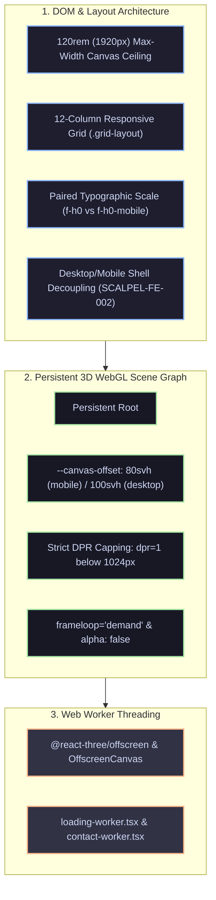

# The Basement Studio System: 120rem Ceilings, WebGL Offscreen Workers & Discrete Stepping

```
Document: SCALPEL-FE-004
Topic: Discrete Typographic Stepping, 120rem Fixed Canvas Ceilings, WebGL svh Offset Anchoring & Offscreen Workers
Status: Production Architecture Standard
Reference Implementation: basementstudio/website-2k25
Target Audience: Creative Technologists, 3D WebGL Engineers, UI Architects, AI Coding Agents
Related Documents: SCALPEL-FE-001, SCALPEL-FE-002, SCALPEL-FE-003
```

---

## 1. Executive Summary: The Award-Winning Creative Agency Paradigm

While **SCALPEL QDPA (SCALPEL-FE-003)** is engineered for product dashboards, SaaS platforms, and AI pair-programming requiring mathematical, continuous scaling from laptop to 4K, **Basement Studio** (`basementstudio/website-2k25`) represents the gold standard for **high-end creative agency engineering and 3D WebGL experiences**.

Basement Studio completely rejects the "Lazy Zoom" (`transform: scale()` or CSS `zoom`) and avoids continuous mathematical slope equations (`clamp()`). Instead, their system is built on **five core architectural pillars**:



---

## 2. Pillar 1: The 120rem (1920px) Canvas Ceiling & 12-Column Bento Grid

A foundational principle of Basement Studio's aesthetic is that a website must **never stretch infinitely into empty space** on ultrawide monitors (21:9) or massive 4K displays.

### The Configuration in `tailwind.config.ts`:
```ts
// tailwind.config.ts
import type { Config } from "tailwindcss";

export default {
  theme: {
    extend: {
      screens: {
        "3xl": "1920px" // Dedicated ultra-wide desktop tier
      },
      maxWidth: {
        full: "120rem"  // 120rem * 16px = 1920px maximum boundary!
      }
    }
  }
} satisfies Config;
```

### The Universal `.grid-layout` Primitive (`src/styles/globals.css`):
```css
@layer utilities {
  .grid-layout {
    @apply mx-auto grid w-full max-w-full grid-cols-4 gap-3 px-4 lg:grid-cols-12;
  }
}
```

### How It Scales Across Viewports:
1. **On Screens $> 1920\text{px}$ (4K, Ultrawides)**:
   - `max-w-full` enforces `max-width: 120rem` (`1920px`).
   - `mx-auto` automatically centers the entire website, introducing balanced, luxurious negative space margins on the left and right.
   - Text measure never exceeds readable limits, and bento cards maintain their tight, structured grid relationships.
2. **On Standard Desktops ($1024\text{px} - 1920\text{px}$)**:
   - Expands fluidly within a **12-column grid** (`lg:grid-cols-12`).
   - Column spans (`col-span-4`, `col-span-7`, `col-span-11`) align headers, imagery, and interactive widgets with architectural discipline.
3. **On Mobile ($< 1024\text{px}$)**:
   - Collapses into a **4-column grid** (`grid-cols-4 gap-3 px-4`).

---

## 3. Pillar 2: Paired Typographic Design Token Hierarchy

Instead of relying on mathematical `clamp()` interpolation, Basement Studio uses **manually tuned typographic tokens**. Creative directors at high-fashion and luxury digital agencies demand exact control over font-size, tracking, and leading across device categories.

### The Token Catalog in `tailwind.config.ts`:
```ts
fontSize: {
  // Massive Hero Headings
  "f-h0": ["6.125rem", { lineHeight: "5.5rem", letterSpacing: "-0.04em", fontWeight: "600" }],       // 98px
  "f-h0-mobile": ["2.875rem", { lineHeight: "2.45rem", letterSpacing: "-0.04em", fontWeight: "600" }],// 46px

  // Primary Section Headings
  "f-h1": ["4.75rem", { lineHeight: "4.25rem", letterSpacing: "-0.04em", fontWeight: "600" }],        // 76px
  "f-h1-mobile": ["2.1875rem", { lineHeight: "2.25rem", letterSpacing: "-0.03em", fontWeight: "600" }],// 35px

  // Card / Module Headings
  "f-h2": ["2.375rem", { lineHeight: "2.25rem", letterSpacing: "-0.04em", fontWeight: "600" }],        // 38px
  "f-h2-mobile": ["1.5rem", { lineHeight: "1.5rem", letterSpacing: "-0.03em", fontWeight: "600" }],   // 24px

  // Subheadings & Callouts
  "f-h3": ["1.5rem", { lineHeight: "1.5rem", letterSpacing: "-0.03em", fontWeight: "600" }],           // 24px
  "f-h3-mobile": ["1.25rem", { lineHeight: "1.25rem", letterSpacing: "-0.03em", fontWeight: "600" }], // 20px

  // Compact Titles & Labels
  "f-h4": ["1.25rem", { lineHeight: "1.25rem", letterSpacing: "-0.02em", fontWeight: "600" }],         // 20px
  "f-h4-mobile": ["0.9375rem", { lineHeight: "1rem", letterSpacing: "-0.02em", fontWeight: "600" }],  // 15px

  // Body & Paragraphs
  "f-p": ["0.8125rem", { lineHeight: "1rem", letterSpacing: "0.0em", fontWeight: "600" }],             // 13px
  "f-p-mobile": ["0.75rem", { lineHeight: "1rem", letterSpacing: "0.0em", fontWeight: "600" }]         // 12px
}
```

### The 3-Tier Responsive Consumption Pattern:
In `src/app/(site)/(canvas)/(content)/(home)/intro.tsx`:
```tsx
<h1 className="text-pretty text-f-h0-mobile lg:text-[5.4375rem] lg:leading-[4.875rem] 3xl:text-f-h0">
  {children}
</h1>

<p className="text-balance text-f-h4-mobile lg:text-f-h4">
  {children}
</p>
```
1. **Tier 1 (Mobile $< 1024\text{px}$)**: Renders `text-f-h0-mobile` (`2.875rem` / 46px).
2. **Tier 2 (Standard Laptop/Desktop $1024\text{px} - 1919\text{px}$)**: Renders `lg:text-[5.4375rem]` (`87px`), perfectly tuned for 14"–16" laptop displays.
3. **Tier 3 (Large Desktop $\ge 1920\text{px}$)**: Renders `3xl:text-f-h0` (`6.125rem` / 98px), commanding the full 120rem canvas.

---

## 4. Pillar 3: Persistent WebGL Canvas Architecture & `svh` Anchoring

Basement Studio's most impressive technical feat is how their 3D WebGL scene coexists with the DOM without interfering with standard layout flow.

### A. The Persistent Global Canvas Layer (`src/components/layout/canvas-layer.tsx`):
```tsx
export const CanvasLayer = () => {
  const isCanvasInPage = useAppLoadingStore((state) => state.isCanvasInPage);
  const canvasVisible = useAppLoadingStore((state) => state.canvasVisible);
  const canvasUnavailable = useAppLoadingStore((state) => state.canvasUnavailable);

  if (canvasUnavailable) return null;

  return (
    <div
      className={cn(
        "canvas-container absolute top-0 h-[var(--canvas-offset)] w-full lg:fixed lg:aspect-auto",
        !canvasVisible && "pointer-events-none invisible fixed opacity-0"
      )}
    >
      {isCanvasInPage && <Scene />}
      <AppLoadingHandler />
      <InspectableViewer />
    </div>
  );
};
```
* **Persistent WebGL Context**: The `<Scene />` is mounted once in the root layout. Route transitions toggle `canvasVisible` rather than unmounting the component. This prevents expensive WebGL context loss and eliminates shader re-compilation pauses.
* **Desktop vs. Mobile Positioning**:
  - **On Desktop**: `lg:fixed lg:aspect-auto top-0 w-full`. The 3D scene stays pinned behind the scrolling DOM content.
  - **On Mobile**: `absolute top-0 h-[var(--canvas-offset)] w-full`. The canvas is absolute and scrolls out of view, saving battery and GPU cycles on mobile devices!

---

### B. The `--canvas-offset` Variable with `svh` Units (`src/components/transitions/transitions.css`):
```css
/* How much room the canvas occupies, and how much space content below reserves */
html {
  --canvas-offset: 80svh; /* Mobile: 80% of small viewport height */
}

@media (min-width: 1024px) {
  html {
    --canvas-offset: 100svh; /* Desktop: 100% of small viewport height */
  }
}

/* Fallback: when canvas is unavailable or route is plain text */
[data-canvas-unavailable="true"] {
  --canvas-offset: 2.25rem; /* Clears navbar height only */
}
```

#### Why `svh` (Small Viewport Height) is Non-Negotiable:
* Standard `100vh` on mobile changes dynamically when the browser URL bar collapses as the user scrolls, triggering jarring layout re-calculations.
* `svh` calculates height based on the **smallest possible viewport height** (when browser toolbars are fully expanded).
* Result: **Zero layout shifts (CLS = 0.00)** during scroll transitions on iOS Safari and Chrome Android!

#### Content Space Reservation (`src/app/(site)/(canvas)/layout.tsx`):
```tsx
export default function CanvasGroupLayout({ children }: { children: React.ReactNode }) {
  return (
    <>
      <Navbar />
      <SetCanvasMode enabled />
      {/* Pushes HTML content down by exact canvas height */}
      <div className="layout-container mt-[var(--canvas-offset)]">
        {children}
      </div>
    </>
  );
}
```

---

## 5. Pillar 4: OffscreenCanvas & Web Worker Thread Isolation

In high-end 3D web applications, parsing 3D geometry files (GLTF/GLB) on the main thread causes dropped frames and stuttering animations. Basement Studio solves this by running Three.js inside **Web Workers using `@react-three/offscreen`**.

### The Worker Pipeline (`src/workers/loading-worker.tsx`):
```tsx
import { render } from "@react-three/offscreen";
import LoadingScene from "@/components/loading/loading-scene";

export type LoadingWorkerMessageEvent = MessageEvent<{
  type: string;
  modelUrl?: string;
}>;

self.addEventListener("message", (e: LoadingWorkerMessageEvent) => {
  const { type, modelUrl } = e.data;

  if (type === "initialize" && modelUrl) {
    // 3D Scene renders entirely on a background thread!
    render(<LoadingScene modelUrl={modelUrl} />);
  }
});
```

### The Contact Form 3D Worker (`src/workers/contact-worker.tsx`):
The interactive 3D model on the contact page is rendered in a separate dedicated worker (`contact-worker.tsx`), receiving message events (`load-model`, `window-resize`, `scale-animation-complete`) from the main React tree.

#### Key Architectural Benefit:
* The main JavaScript thread is **100% dedicated to DOM hydration, user clicks, and CSS transitions**.
* Heavy 3D shader compilation and vertex parsing occur silently in the background worker.

---

## 6. Pillar 5: Mobile GPU & Performance Defenses

To maintain 60 FPS on lower-end mobile phones without GPU thermal throttling, Basement Studio implements three defenses:

### Defense 1: Strict Mobile DPR Capping
In `src/components/scene/index.tsx`:
```tsx
// DPR is capped at 1 below the desktop breakpoint: rendering the 80svh
// mobile canvas at retina resolution roughly quadruples the per-frame GPU
// and post-processing cost on phones already struggling with INP.
const [dpr, setDpr] = useState<number | [number, number]>(() =>
  typeof window !== "undefined" && window.innerWidth < 1024 ? 1 : [1, 2]
);
```
* On mobile ($< 1024\text{px}$): `dpr = 1`. A 3x Retina phone (like iPhone 15 Pro) would require rendering **$9\times$ the pixels** if unconstrained. Capping DPR to 1 keeps GPU fill-rate minimal.
* On desktop ($\ge 1024\text{px}$): Bracketed dynamically between `[1, 2]`.

### Defense 2: `frameloop="demand"`
```tsx
<Canvas
  id="canvas"
  frameloop="demand" // Does not run an unconstrained 120fps render loop!
  dpr={dpr}
  gl={{
    antialias: false, // Disables native MSAA; custom shaders handle post-processing
    alpha: false,     // Eliminates transparent framebuffer compositing overhead
    outputColorSpace: THREE.SRGBColorSpace,
    toneMapping: THREE.NoToneMapping
  }}
  camera={{ fov: 60 }}
/>
```

### Defense 3: Edge Route Proxying (`src/proxy.ts`)
Rather than running device detection inside Next.js page components (which would force dynamic SSR rendering and disable caching), mobile redirection for heavy interactive routes runs in Next.js Edge middleware:
```ts
// src/proxy.ts
export function proxy(request: NextRequest) {
  const { pathname } = request.nextUrl;

  // Mobile visitors to /lab go to the lightweight external lab site
  if (pathname === "/lab") {
    const { device } = userAgent(request);
    const isMobile = device.type === "mobile" || device.type === "tablet";
    if (isMobile && !isbot(request.headers.get("user-agent") ?? "")) {
      return NextResponse.redirect("https://lab.basement.studio/");
    }
  }
  return NextResponse.next();
}
```
* The Next.js page itself remains **100% statically prerendered with Next.js Cache Components (`cacheComponents: true`)**.

---

## 7. Pillar 6: Layout Decoupling & Defensive CSS Guards

### A. Desktop vs. Mobile Layout Orchestration:
Basement Studio strictly follows the decoupled layout pattern codified in **SCALPEL-FE-002**:
In `src/components/layout/navbar-content.tsx`:
```tsx
<DesktopContent
  year={year}
  links={links}
  socialLinks={socialLinks}
  newsletter={newsletter}
/>

<MobileContent
  year={year}
  links={links}
  socialLinks={socialLinks}
  newsletter={newsletter}
/>
```
* `DesktopContent`: Uses `hidden lg:flex` with horizontal pill items.
* `MobileContent`: Mounts via `<Portal id="mobile-menu">` with `h-[calc(100dvh-35px)]`, `top-[35px]`, `focusTrapRef`, and `useScrollControl`.
* **Zero `isMobile` Props**: Shared components remain pure and layout-agnostic.

### B. Defensive CSS Rules:
1. **`overflow-x: clip`**: Used on containers to eliminate horizontal scrollbars without breaking `position: sticky`.
2. **`overscroll-behavior: none`**: Applied to `html` to prevent rubber-band bounce on trackpads and iOS.
3. **`text-wrap: balance` & `text-wrap: pretty`**: Automatically applied to paragraphs to eliminate typographical orphans.

---

## 8. Comparative Matrix: Basement Studio vs. SCALPEL QDPA

| Architectural Feature | Basement Studio (`website-2k25`) | SCALPEL QDPA (`SCALPEL-FE-003`) | Best Use Case |
| :--- | :--- | :--- | :--- |
| **Scaling Mechanics** | Discrete Breakpoint Stepping (`mobile` $\to$ `lg` $\to$ `3xl`) | Continuous Dual-Axis Fluid Anchor (DRFA: `clamp(0.875rem, min(W, H), 1.375rem)`) | Basement for handcrafted typography; SCALPEL for automatic multi-monitor parity. |
| **Max-Width Ceiling** | `max-w-[120rem]` (`1920px`) | `max-w-[112.5rem]` (`1800px`) via `--canvas-max-width` | Both systems prevent 4K/Ultrawide stretching with centered negative margins. |
| **3D Canvas Offset** | `--canvas-offset: 80svh / 100svh` | Decoupled Proportional Canvas | Basement is gold-standard for WebGL space reservation without layout shift. |
| **GPU Fill-Rate Defense** | Strict DPR capping (`dpr = 1` on mobile) | Subpixel vector rasterization | Basement is essential for mobile 3D performance. |
| **Thread Isolation** | `@react-three/offscreen` in Web Workers | Main thread layout computation | Basement guarantees 60fps UI while loading complex 3D assets. |
| **AI Ergonomics** | Low: AI must manage paired responsive classes manually | High: AI writes standard Tailwind `rem` or `--px`; root scales it automatically. | SCALPEL for AI-driven rapid development. |

---

## 9. The Ultimate Synthesis: The "10/10" Unified Architecture

For engineering teams seeking the highest aesthetic fidelity and technical performance:

1. **Use SCALPEL QDPA for DOM Layout & Fluid Typography**:
   - Apply the Dual-Axis Fluid Anchor (`min(100vw/90, 100vh/56.25)`) to eliminate multi-monitor layout disparity and prevent ultrawide vertical fold cutoffs.
   - Use the `--px: calc(1rem / 16)` bridge for effortless AI coding.
2. **Use Basement Studio's WebGL Architecture for 3D Layers**:
   - Mount persistent 3D canvases at the root layout with `--canvas-offset: 80svh / 100svh`.
   - Cap mobile `dpr = 1` below 1024px.
   - Run background 3D loaders in Web Workers via `@react-three/offscreen`.
3. **Enforce the 120rem Max-Width Ceiling**:
   - Lock all desktop canvases to a max-width of `1800px`–`1920px` to preserve visual hierarchy across 4K and 34" ultrawide displays.
