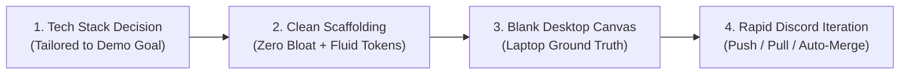
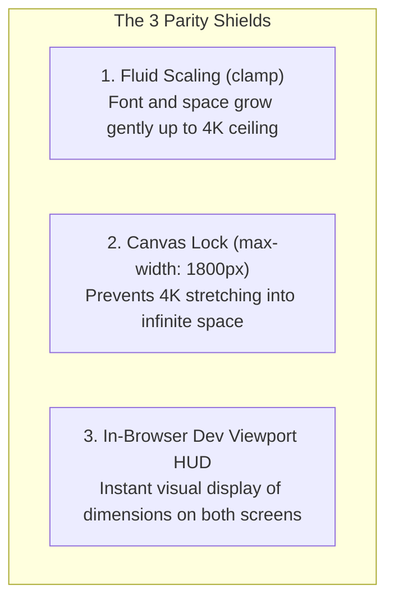
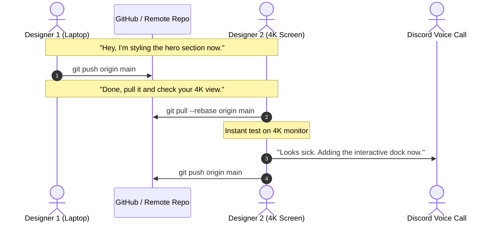

# Envy Studio: Workspace Setup & Two-Designer Collaborative Git Workflow

```
Document: SCALPEL-WRK-001
Topic: Studio Tech Stack Scaffolding, Screen Disparity Elimination & Rapid Git Collaboration
Status: Priority 1 Standard
Target Audience: Envy Studio Designers, Creative Technologists, AI Coding Agents
```

---

## 1. The Envy Studio Design Lifecycle

At **Envy Studio**, every project follows a streamlined, design-first three-step pipeline:



### Step 1: The Tech Stack Decision Matrix
We choose the stack based strictly on what the demo requires—no unnecessary heavy frameworks when a lightweight tool is faster:

| Demo Type | Recommended Stack | Rationale |
| :--- | :--- | :--- |
| **Pure Visual / Concept Showcase** | **Vite + React (or Vanilla) + Tailwind/CSS Modules** | Instant HMR, zero server complexity, lightning fast builds, static hosting on Vercel/Cloudflare Pages. |
| **Interactive App / Dashboard Demo** | **Next.js (App Router) + TypeScript + Tailwind + Lucide** | Built-in routing, API mock endpoints, fast layout nesting, easy integration with serverless auth/db. |
| **Dynamic Data / Database Prototype** | **Next.js + Supabase + Zod** | Real-time database, auth without custom backend, instant tables. |

### Step 2: The Clean Scaffolding Standard
When scaffolding a new project, immediately strip default template clutter (no default Next.js logos, no template boilerplates). Immediately wire in:
1. The **SCALPEL Fluid Scaling Tokens** (`clamp()` variables for font and spacing).
2. The **Supreme Canvas Container** (`max-width: 1800px`, centered, padding guard).
3. The **Production Comment Stripper** (`sourcemap: false` in bundler config).

---

## 2. Eliminating the Two-Designer Screen Disparity

### The Reality:
* **Designer 1 (You):** Laptop screen (e.g., 14" display, `1440x900` or `1536x864` effective viewport).
* **Designer 2 (Your Friend):** Massive external monitor (e.g., 27" or 32" 4K display, `2560x1440` or `3840x2160`).

When Designer 1 builds a layout, it fits their laptop view perfectly. But when Designer 2 pulls the code, unconstrained layouts stretch, cards spread miles apart, or text looks microscopic.

### The 3-Step Screen Parity System



#### Shield 1: Fluid Typography & Spacing (Already baked into `:root`)
Never use static `px`. Typography and gaps scale dynamically between `1024px` and `2560px` using the mathematical `clamp()` tokens defined in `SCALPEL-FE-001`.

#### Shield 2: The 1800px Canvas Ceiling
On Designer 2's huge screen, all content remains locked inside `<div class="supreme-canvas">`. It stays beautifully framed and centered, with the background extending full-bleed. It never feels empty or distorted.

#### Shield 3: The Envy Studio Dev Viewport HUD (Drop-in Helper)
Add this tiny component during development so both designers can instantly see exact viewport widths and detect overflows while on a Discord call:

```tsx
// src/components/dev/ViewportHUD.tsx
import { useState, useEffect } from "react";

export function ViewportHUD() {
  if (process.env.NODE_ENV === "production") return null;

  const [dims, setDims] = useState({ width: 0, height: 0 });

  useEffect(() => {
    function update() {
      setDims({ width: window.innerWidth, height: window.innerHeight });
    }
    update();
    window.addEventListener("resize", update);
    return () => window.removeEventListener("resize", update);
  }, []);

  return (
    <div style={{
      position: "fixed",
      bottom: "12px",
      right: "12px",
      padding: "4px 8px",
      fontSize: "11px",
      fontFamily: "monospace",
      background: "rgba(0, 0, 0, 0.8)",
      color: "#00ff66",
      borderRadius: "4px",
      zIndex: 99999,
      pointerEvents: "none",
      border: "1px solid rgba(255, 255, 255, 0.1)"
    }}>
      {dims.width}px × {dims.height}px | {dims.width >= 1800 ? "4K Canvas Locked" : "Fluid Laptop Range"}
    </div>
  );
}
```

---

## 3. The Two-Designer Git Workflow: Fast Discord Collaboration

Because both designers review work live on Discord and trust each other completely, **formal PR review gates, branch protection approvals, and bureaucratic processes are eliminated**.

The goal is **maximum velocity with zero git mess**.



---

## 4. The Golden Rule: Always Pull with `--rebase`

The number one reason two fast-moving developers get tangled git histories is running standard `git pull`, which creates messy, recurring "Merge branch 'main' of github.com..." merge commits.

### The Solution: Rebase by Default
Configure Git once on both machines:
```bash
git config --global pull.rebase true
```

### The Standard 3-Command Loop:
Before starting work or pushing changes:
```bash
# 1. Grab collaborator's latest changes cleanly
git pull --rebase

# 2. Stage and commit your changes
git add .
git commit -m "style: hero headline and action pill"

# 3. Push directly to main
git push origin main
```

---

## 5. Conflict Prevention Strategy

Even with Discord communication, two designers editing the exact same file at the exact same line will cause a merge conflict. Follow these three rules to keep conflicts at zero:

### 1. Component-Level Division of Labor
* **Designer 1:** Works on `src/components/HeroSection.tsx` and its styles.
* **Designer 2:** Works on `src/components/NavigationDock.tsx` or `src/components/BentoGrid.tsx`.
* As long as you edit different component files, Git will auto-merge your pushes with 100% success—even if both components are imported into `App.tsx`.

### 2. Lockfile Hygiene (NPM / PNPM / Bun)
* If one designer installs a package, notify the other on Discord: *"Hey, installed Lucide, do a pull before running `npm install`."*
* Never resolve package lock conflicts manually. If `package-lock.json` conflicts:
  ```bash
  git checkout --theirs package-lock.json
  npm install
  git add package-lock.json
  git rebase --continue
  ```

### 3. If a Merge Conflict Happens During Rebase:
Don't panic. Git pauses and highlights the conflict:
```bash
# 1. Open the conflicted file in your editor (look for <<<<<<< HEAD)
# 2. Pick the correct styling or keep both
# 3. Mark resolved:
git add <conflicted-file>

# 4. Continue the rebase (DO NOT run git commit):
git rebase --continue

# 5. Push cleanly:
git push origin main
```

---

## 6. Live Preview & Instant Visual Sync

To view changes together without waiting for Git pushes:

1. **Vercel / Cloudflare Auto-Deploy:**
   - Every push to `main` automatically triggers a 20-second production preview deployment.
   - Designer 2 can simply refresh the live Vercel URL on their 4K screen while Designer 1 works on their laptop.
2. **Local Tunneling (Instant Live Pair Design):**
   - If you want Designer 2 to see your localhost live while on Discord:
     ```bash
     npx cloudflared tunnel --url http://localhost:5173
     # or
     npx ngrok http 5173
     ```
   - Designer 2 opens the tunnel URL on their massive screen, and can see Designer 1's live updates in real-time.

---

## 7. AI Agent Operational Directives

1. **Always scaffold projects with the SCALPEL Fluid Tokens and Supreme Canvas wrapper.**
2. **Include the `ViewportHUD` component in development builds** so designers can verify viewport sizes.
3. **Keep components strictly modularized into separate files** (`HeroSection.tsx`, `BentoGrid.tsx`) so the two designers can push and pull simultaneously without Git merge conflicts.
4. **Never introduce complex Git hooks or blocking CI scripts** that require pull request approvals for demo projects. Keep the trunk-based flow frictionless.
