# PROJECT SCALPEL 🔪
> **The Definitive Engineering Standard for 10/10 Code, Design-First Scalability, and Zero-Regression Systems.**

---

## 1. What is Project SCALPEL?

**Project SCALPEL** is a living, research-backed repository of engineering standards, architecture blueprints, and code-writing disciplines. It exists to bridge the gap between code that merely *functions* and code that is **maintainable, scalable, and resilient**.

### Top Priority: Design-First Scaling & Strict Agentic Precision
Per project directives, **Frontend & Design-First Architecture is the supreme #1 priority**. 
When designing on a laptop, that layout is the **Supreme Ground Truth**—it must scale fluidly without breaking, stretching into awkward empty space on massive 4K monitors, or crunching on compact screens.

### Dual-Purpose Architecture
1. **For Humans & Designers (Envy Studio):**  
   Written with an unbiased, plain-English, high-signal tone. No academic pretension, no hand-waving dogmatism. Every principle is paired with concrete rationale ("why this matters"), real-world failure modes, and clear mental models.
2. **For AI Coding Agents:**  
   Structured as deterministic, machine-parsable specifications. AI agents must obey short prompts 1:1, never hallucinate unrequested features or libraries, and never question aesthetic/typography choices for demo prototypes.

---

## 2. Priority 1 Architecture: Design-First Layouts & Workflow

```mermaid
graph TD
    classDef priority fill:#4c1d95,stroke:#8b5cf6,stroke-width:2px,color:#fff;
    classDef sec fill:#7f1d1d,stroke:#ef4444,stroke-width:2px,color:#fff;
    classDef agent fill:#701a75,stroke:#d946ef,stroke-width:2px,color:#fff;
    classDef work fill:#064e3b,stroke:#10b981,stroke-width:2px,color:#fff;

    P["PROJECT SCALPEL"]

    P --> FE["Priority 1: Design-First Frontend"]:::priority
    P --> AG["Priority 1: AI Strict 1:1 Obedience"]:::agent
    P --> WK["Priority 1: Envy Studio 2-Designer Workflow"]:::work
    P --> SE["Priority 1: Vibecoding Security Defenses"]:::sec
    P --> CL["Priority 1: DevTools Stealth & Clean Code"]:::priority

    FE --> F1["Fluid Scaling (clamp: Laptop to 4K)"]
    FE --> F2["Desktop-First / Mobile-Later Separation"]
    FE --> F3["Zero Layout Snapping / Stretch Prevention"]

    AG --> A1["1:1 Short Prompt Obedience"]
    AG --> A2["Zero Unsolicited Code or Packages"]
    AG --> A3["Unquestioned Aesthetic & Font Freedom"]

    WK --> W1["Laptop vs Huge Monitor Screen Parity"]
    WK --> W2["No-Permission Discord Git Merging"]
    WK --> W3["Pull-Rebase-Push Protocol"]

    SE --> S1["Server Action Endpoint Protection"]
    SE --> S2["Edge Rate Limiting & Denial-of-Wallet"]
    SE --> S3["NEXT_PUBLIC_ Secret Leak Prevention"]

    CL --> C1["Zero Comments in Production Bundles"]
    CL --> C2["sourcemap: false (DevTools Stealth)"]
    CL --> C3["drop_console & Self-Documenting Code"]
```



---

## 3. The SCALPEL Document Index

### 👑 Phase 1: High-Priority Standards (Active & Published)

| Document | Topic | Description |
| :--- | :--- | :--- |
| **[`ingest.md`](file:///C:/websites/SCALPEL/ingest.md)** | **Project Ingest Protocol** | Central preservation protocol using the `[i]` tag to scan and ingest ephemeral scratchpad findings into permanent documentation. |
| **[`handover.md`](file:///C:/websites/SCALPEL/handover.md)** | **Project Handover Document** | Standardized living handover record updated at project close, verifying code quality with Ponytail and SCALPEL compliance sign-off. |
| **[`03-frontend-architecture/01-design-first-responsive-scaling.md`](file:///C:/websites/SCALPEL/03-frontend-architecture/01-design-first-responsive-scaling.md)** | **Fluid Scaling (Laptop to 4K)** | Mathematical `clamp()` slope formulas, preserving the designer's laptop layout on massive 4K monitors, `@container` queries, and layout shields. |
| **[`03-frontend-architecture/02-desktop-first-component-layout-separation.md`](file:///C:/websites/SCALPEL/03-frontend-architecture/02-desktop-first-component-layout-separation.md)** | **Desktop-First, Mobile-Later** | Decoupling pure shared components from layout orchestrators. How to build desktop-first with 100% fidelity without component pollution. |
| **[`03-frontend-architecture/03-quantum-dynamic-proportional-architecture.md`](file:///C:/websites/SCALPEL/03-frontend-architecture/03-quantum-dynamic-proportional-architecture.md)** | **Quantum Dynamic Proportional Architecture (QDPA)** | The definitive standard solving the Lazy Zoom vs Fluid Clamp trilemma: Dual-Axis DRFA, zero-transform portal escape, DirectWrite subpixel crispness, and mobile quarantine. |
| **[`03-frontend-architecture/04-basement-studio-hybrid-canvas-architecture.md`](file:///C:/websites/SCALPEL/03-frontend-architecture/04-basement-studio-hybrid-canvas-architecture.md)** | **The Basement Studio System** | 120rem max-width canvas ceilings, WebGL svh offset anchoring, mobile DPR capping, and OffscreenCanvas Web Worker threading. |
| **[`04-agentic-execution-playbook/01-ai-agent-strict-obedience-rules.md`](file:///C:/websites/SCALPEL/04-agentic-execution-playbook/01-ai-agent-strict-obedience-rules.md)** | **Strict 1:1 AI Obedience** | Banning hallucinated helpfulness. Short prompt adherence, zero unasked-for libraries, zero aesthetic pushback on fonts/colors. |
| **[`02-backend-architecture/04-vibecoding-security-defenses.md`](file:///C:/websites/SCALPEL/02-backend-architecture/04-vibecoding-security-defenses.md)** | **Vibecoding Security Defenses** | Next.js Server Action public endpoint vulnerabilities, edge rate limiting, `NEXT_PUBLIC_` secret leaks, XSS sanitization, and SQL injection prevention. |
| **[`01-universal-engineering/03-clean-code-and-comment-stripping.md`](file:///C:/websites/SCALPEL/01-universal-engineering/03-clean-code-and-comment-stripping.md)** | **DevTools Stealth & Clean Code** | Writing self-documenting code with fewer comments; configuring Vite, Next.js, and Terser to strip all comments and disable production sourcemaps. |
| **[`05-workspace-and-collaboration/01-envy-studio-two-designer-git-workflow.md`](file:///C:/websites/SCALPEL/05-workspace-and-collaboration/01-envy-studio-two-designer-git-workflow.md)** | **Envy Studio 2-Designer Git System** | Tech stack selection, fixing the small laptop vs huge screen disparity, and rapid Discord-based git workflow (pull `--rebase`, auto-merging). |
| **[`00-manifesto/01-the-10-out-of-10-standard.md`](file:///C:/websites/SCALPEL/00-manifesto/01-the-10-out-of-10-standard.md)** | **The 10/10 Standard Manifesto** | The core engineering mindset: Shifting focus from "how to make it work" to "maintainable, scalable, resilient." |

---

### 📚 Phase 2: Universal & Deep-Dive Modules (Roadmap)

```text
SCALPEL/
├── 01-universal-engineering/
│   ├── 01-solid-in-practice.md                        # Concrete refactors, failure modes & anti-patterns
│   ├── 02-automated-testing-and-testability.md        # Test pyramid, test doubles, DI, flake elimination
│   └── 04-ci-cd-and-quality-gates.md                  # Static analysis, strict typing, SAST/DAST pipelines
│
├── 02-backend-architecture/
│   ├── 01-clean-and-hexagonal-architecture.md         # Ports & adapters, domain purity, dependency inversion
│   ├── 02-api-idempotency-and-contract-safety.md      # Idempotency keys, distributed locks, retry semantics
│   ├── 03-database-performance-and-indexing.md        # N+1 elimination, composite B-tree indexes, EXPLAIN ANALYZE
│   └── 05-async-messaging-and-event-streams.md        # Kafka, RabbitMQ, transactional outbox, deduplication
│
├── 03-frontend-architecture/
│   ├── 03-headless-design-systems.md                  # Compound components, accessible primitives, token architectures
│   └── 04-accessibility-and-semantic-ui.md            # WCAG 2.2 AA/AAA, keyboard traps, focus rings, semantic DOM
│
└── 04-agentic-execution-playbook/
    └── 02-code-review-rubric-10-out-of-10.md          # The 10/10 Scorecard for PR approval
```

---

## 4. The 5 SCALPEL Authoring Invariants

1. **Zero Fluff:** Get straight to the principle, mechanism, and execution.
2. **Design Supremacy:** The desktop master layout must scale mathematically via `clamp()` without stretching into awkward voids on large screens.
3. **1:1 Prompt Obedience:** Never add unrequested packages, features, or commentary.
4. **Production Stealth:** Strip comments and disable source maps in production builds.
5. **Defensive by Default:** Sanitize inputs, rate-limit endpoints, and protect against silent failure.
