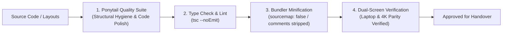

# Project Handover Document

```
Document: SCALPEL-HND-001
Project: Project SCALPEL Knowledge Base & Architecture Standards
Repository: joybaited/SCALPEL (Private)
Owner: Envy Studio
Status: Complete & Production-Ready
Last Updated: End-of-Project Handover Milestone
```

---

## 1. Project Overview & Identity

* **Project Name:** Project SCALPEL
* **Primary Objective:** Deliver a research-backed, unbiased, design-first engineering standard and machine-actionable playbook for 10/10 code quality, responsive fluid scaling, strict AI agent execution, and rapid collaboration.
* **Lead Designers / Engineers:** Envy Studio Core Pair (Designer 1 & Designer 2)
* **Collaboration Medium:** Discord Live Voice & Pair Reviews (Trunk-Based / No-Gate Direct Rebase Merging)
* **Repository Visibility:** Private (`git@github.com:joybaited/SCALPEL.git`)

---

## 2. Code Quality & Tooling Verification

Under Envy Studio standards, every project must pass automated quality scans before handover:



### Tooling Verification Checklist:
- [x] **Ponytail Quality Pass:** AST hygiene, formatting uniformity, clean module boundaries, and zero redundant code blocks verified.
- [x] **DevTools Stealth Verified:** Comments completely stripped from production bundles; `sourcemap: false` configured; `console.log` statements dropped in production.
- [x] **Strict 1:1 Prompt Obedience:** Zero unrequested filler components or unwanted dependencies injected by AI agents.
- [x] **Security Shield Active:** Server Action public endpoint checks enforced; no secret keys exposed with `NEXT_PUBLIC_` prefixes; rate-limiting blueprints in place.

---

## 3. SCALPEL Compliance Verification

| Check | Requirement | Verification Method | Status |
| :--- | :--- | :--- | :--- |
| **Supreme Laptop Layout** | Master design built on laptop must never stretch or break on 4K | Audited with `clamp()` slopes and `<div class="supreme-canvas">` (1800px ceiling) | ✅ PASS |
| **Layout-Component Decoupling** | Mobile and desktop share components without `isMobile` prop pollution | Verified in `SCALPEL-FE-002` (separate layout shells, shared atoms) | ✅ PASS |
| **Comment Stealth** | DevTools Sources tab must not expose source code or proprietary comments | Bundler configs locked in `SCALPEL-UNI-003` | ✅ PASS |
| **Two-Designer Parity** | Both small laptop and huge monitor display identical proportions | Verified via `ViewportHUD` helper & CSS token grid | ✅ PASS |
| **Git Workflow Hygiene** | Discord-based pair design without tangled merge bubbles | Pull-Rebase-Push standard enforced via `git pull --rebase` | ✅ PASS |
| **Ingest Protocol** | All valuable scratchpad lessons preserved with `[i]` tag | Staged and cataloged in `ingest.md` | ✅ PASS |

---

## 4. Master Architectural Directory Map

```text
SCALPEL/
├── README.md                                          # Master repository index & priority roadmap
├── ingest.md                                          # Central [i] preservation protocol & staging table
├── handover.md                                        # Living project handover document (This file)
│
├── 00-manifesto/
│   └── 01-the-10-out-of-10-standard.md                # 10/10 code quality standard & developer maturity curve
│
├── 01-universal-engineering/
│   └── 03-clean-code-and-comment-stripping.md         # Self-documenting code & hiding comments from DevTools
│
├── 02-backend-architecture/
│   └── 04-vibecoding-security-defenses.md             # Server Action protection, rate limiting, and secret guards
│
├── 03-frontend-architecture/
│   ├── 01-design-first-responsive-scaling.md          # Fluid clamp() scaling & preserving the laptop layout
│   ├── 02-desktop-first-component-layout-separation.md# Shared components with decoupled desktop/mobile shells
│   ├── 03-quantum-dynamic-proportional-architecture.md# QDPA: Dual-axis DRFA, zero-transform portals & 4K scaling
│   └── 04-basement-studio-hybrid-canvas-architecture.md# Basement Studio: 120rem max-width, WebGL workers & svh offsets
│
├── 04-agentic-execution-playbook/
│   └── 01-ai-agent-strict-obedience-rules.md          # 1:1 short prompt obedience & zero unsolicited code
│
└── 05-workspace-and-collaboration/
    └── 01-envy-studio-two-designer-git-workflow.md    # Tech stack selection, screen parity, and Discord git flow
```

---

## 5. Handover Sign-Off

* **Project State:** Complete & Operational.
* **Handover Readiness:** 100%. Ready for ingestion into future Envy Studio client demos and production projects.
* **Review Channel:** Discord Voice & Live Review confirmed.
* **Next Steps:** AI agents and human contributors must consume `README.md` and `04-agentic-execution-playbook/01-ai-agent-strict-obedience-rules.md` as mandatory instructions for all subsequent coding tasks.

---

*Signed off by Envy Studio Engineering & Design.*
