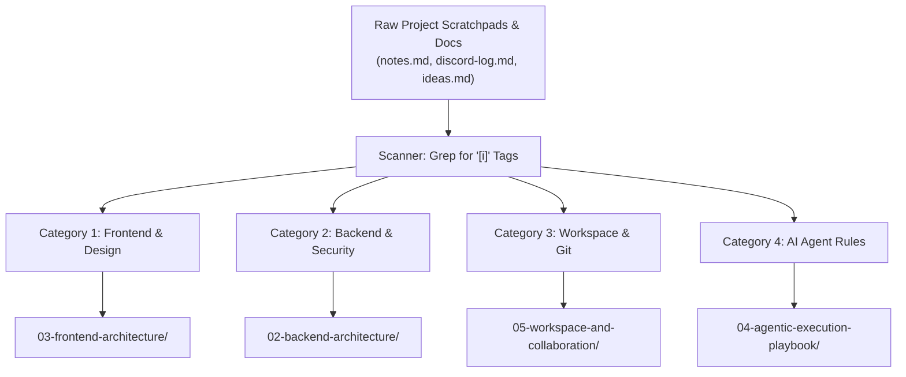

# Project Ingest Protocol: The `[i]` Preservation System

```
Document: SCALPEL-ING-001
Topic: Ephemeral Document Tagging, Extraction, and Centralized Ingestion
Status: Active Standard
Target Audience: Designers, Engineers, Autonomous AI Agents
```

---

## 1. The Core Purpose: Preventing Knowledge Evaporation

During fast-paced design and engineering cycles at **Envy Studio**, dozens of ephemeral documents are produced:
* Scratchpad notes and brainstorms
* Discord conversation takeaways
* One-off bug investigations
* Prototype experimentation logs
* Client feedback transcripts

Without a systematic capture mechanism, 95% of the insights gained during a project vanish into dead files or chat history once the project ships.

### The SCALPEL `[i]` Standard
> **Any insight, pattern, design token, or invariant that must survive beyond the active sprint must be marked with an `[i]` tag.**  
> At the end of every project or milestone, an automated/systematic Ingest cycle extracts all `[i]`-tagged items, synthesizes them, and merges them into their permanent home in SCALPEL.

---

## 2. How to Tag While Working: The `[i]` Syntax

While writing scratchpads, PR notes, or internal docs, place `[i]` next to any finding that represents permanent value:

### 1. Invariant / Architecture Rule:
```markdown
### [i] Rule: Aspect-Ratio Shield for Video Modals
Never let video previews calculate their own heights in flex rows. Always force:
`aspect-ratio: 16 / 9; object-fit: cover; flex-shrink: 0;`
Otherwise Safari 17.2 collapses the container to 0px height.
```

### 2. Design Token or Fluid Formula:
```markdown
> [!NOTE] [i] Token Update: High-Density 4K Header Padding
> On screens wider than 2000px, header horizontal padding should switch to:
> `padding-inline: clamp(2rem, 1rem + 3vw, 5rem);`
```

### 3. Security / Backend Defense:
```markdown
- [i] **Security Alert:** Any Supabase storage upload endpoint must validate MIME type server-side, not just rely on the frontend file extension filter.
```

### 4. Git / Workspace Habit:
```markdown
- [i] **Workflow Note:** When working with Framer Motion and Tailwind simultaneously in Vite, always mark animation variants outside the render function to eliminate re-allocation stutters.
```

---

## 3. The End-of-Project Ingest Cycle

At the conclusion of each demo or milestone (right before updating `handover.md`), execute the **3-Step Ingestion Pipeline**:



### Step 1: Scan & Extract
Run a quick search across all workspace `.md` files for the tag:
```bash
# PowerShell extraction
Get-ChildItem -Recurse -Filter *.md | Select-String -Pattern "\[i\]"
```

### Step 2: Categorize and Deduplicate
Group findings by domain:
1. **Frontend & Styling:** (Typography, scaling, flex bugs, layout quirks)
2. **Backend & Security:** (Auth gaps, caching traps, rate limits, API patterns)
3. **Tooling & Code Quality:** (Ponytail rules, Vite/Next bundler tweaks, linters)
4. **Agent Rules:** (Prompts that failed and the negative constraints needed to fix them)

### Step 3: Ingest into Master SCALPEL Modules
Append or integrate the refined rules into the permanent master docs:
* Layout lessons -> `03-frontend-architecture/`
* Security bugs -> `02-backend-architecture/`
* Tooling -> `05-workspace-and-collaboration/`
* Agent constraints -> `04-agentic-execution-playbook/01-ai-agent-strict-obedience-rules.md`

---

## 4. Active Ingest Staging Area

Use this section below as the central collection queue for pending `[i]` tags from current work before they are dispatched into master documents:

| Tagged Date | Source Document / Context | Category | Ingestion Status |
| :--- | :--- | :--- | :--- |
| *Active* | *Workspace Initialization* | *Frontend* | Ingested -> `SCALPEL-FE-001` (Supreme Canvas & `clamp()`) |
| *Active* | *Display Calibration Review* | *Frontend* | Ingested -> `SCALPEL-FE-002` (Desktop-First Layout Decoupling) |
| *Active* | *Lazy Zoom vs Fluid Rem Investigation* | *Frontend* | Ingested -> `SCALPEL-FE-003` (Quantum Dynamic Proportional Architecture) |
| *Active* | *Basement Studio Architecture Reverse-Eng* | *Frontend* | Ingested -> `SCALPEL-FE-004` (Basement Studio 120rem & WebGL Workers) |
| *Active* | *AI Prompt Behavior* | *Agentic* | Ingested -> `SCALPEL-AGT-001` (Zero Unsolicited Code) |
| *Active* | *Production Build Review* | *Build* | Ingested -> `SCALPEL-UNI-003` (DevTools Comment Stripping) |
| *Active* | *Security Audit* | *Backend* | Ingested -> `SCALPEL-SEC-001` (Vibecoding Security Protections) |
| *Active* | *Discord Pair Design* | *Workflow* | Ingested -> `SCALPEL-WRK-001` (2-Designer Rebase Protocol) |

---

## 5. AI Agent Operational Directive

1. When instructed to **"ingest"** or **"run ingest"**, parse all workspace documents for `[i]` markers.
2. Synthesize related findings and update the corresponding canonical SCALPEL document.
3. Remove the processed tags from temporary scratchpads to prevent duplicate ingestion.
4. Record the ingestion event in the table above.
