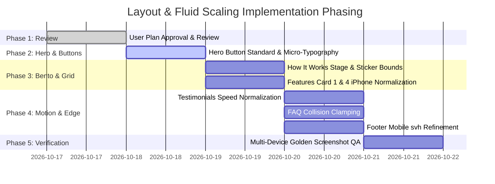

# MASTER LAYOUT & FLUID SCALING ARCHITECTURE PLAN
## LARPZ WALLET — ELITE FRONTEND POLISH & RESPONSIVE MASTERPLAN

```
Document: LARPZ-MASTER-LAYOUT-PLAN
Version: 1.0.0 (Production Blueprint)
Status: Pending User Review (NO CODE MODIFICATIONS APPLIED YET)
Architect: Elite Frontend Layout Specialist & Master Plan Architect
Target Engine: Next.js 15 (App Router), Tailwind CSS v4, GSAP, Embla Carousel
Design References: MetaMask.io, Basement Studio (website-2k25), Cash App, Linear.app, Awwwards SOTD
```

---

## 1. Executive Summary & Design Benchmark Evaluation

The goal of this architectural blueprint is to elevate **Larpz Wallet** to the pinnacle of creative web development, matching the technical craftsmanship and visual prestige of **MetaMask**, **Basement Studio**, **Cash App**, and **Linear**.

### 1.1 Comparative Benchmark Matrix

| Design Reference | Signature Strength | Larpz Current State | Master Plan Target Architecture |
| :--- | :--- | :--- | :--- |
| **MetaMask** | • Fluid column bento grid (~90svh fixed height)<br/>• Iconic spring-overshoot pill hover (`cubic-bezier(0.4, 1.35, 0.5, 0.97)`)<br/>• Double-line text roll without descender clipping | • Pill button hover faithfully implemented in `pillHover.tsx`<br/>• How It Works uses 3-column split (`1fr 1.066fr 1fr`)<br/>• Hero desktop action buttons use raw `%` boxes | • Standardize all buttons to use `<PillButton>` with dual-axis rem/clamp metrics<br/>• Harmonize How It Works aspect ratios across 13" laptop, 1080p, 1440p, and 4K |
| **Basement Studio** (`website-2k25`) | • Strict 120rem (1920px) maximum canvas ceiling<br/>• Desktop/Mobile shell decoupling<br/>• Discrete, curated typographic scale (`f-h0` to `f-p`)<br/>• WebGL / hybrid canvas integration | • Sections currently stretch unbounded or use varied max-widths (`1200px`, `1850px`)<br/>• Hero has partial decoupling (DOM split at `lg`) | • Enforce 120rem master ceiling on wide displays to prevent 4K ballooning<br/>• Decouple layout coordinates so mobile and desktop never conflict<br/>• Unify spacing tokens to prevent layout blowouts |
| **Cash App** | • Bold micro-typography & tracked uppercase CTAs<br/>• Floating physics stickers with locked anchors<br/>• Playful yet razor-sharp layout hierarchy | • Floating stickers present across Hero, Steps, Features, FAQ, Pricing<br/>• Recent commits locked stickers to stage in HowItWorks (`6ef75ef`) | • Universal stage-locked percentage coordinates for all stickers across all sections<br/>• Add defensive bounds check on tablet viewports (768px - 1024px) |
| **Linear** | • Razor-sharp contrast, subpixel font crispness<br/>• Zero layout shift (CLS = 0.00)<br/>• Dual-axis viewport protection (`min-h-[100svh]` without fold cutoff) | • Fluid typography using `clamp()` in several sections<br/>• Hero text and pricing cards occasionally overflow on short viewports | • Apply SCALPEL Dual-Axis Dynamic Root Fluid Anchor (DRFA) logic: `min(100vw/90, 100vh/56.25)`<br/>• Guarantee fold safety on short laptops (e.g. 1366x768 / 1440x900) |
| **Awwwards SOTD** | • Bespoke micro-interactions & cursor trails<br/>• Fluid momentum carousels with edge-peeking<br/>• Seamless continuous marquee loops | • Codrops Image Trail variant 3 active in Hero<br/>• Embla click-carousel active in Features<br/>• Double marquee active in Testimonials | • Fine-tune Embla card aspect ratios and container query scaling<br/>• Ensure marquee velocity is constant in physical pixels/sec across viewports<br/>• Perfect sticker z-indexing and collision barriers |

---

## 2. Universal Principles: Micro-Typography, Button Mechanics & Fluid Scaling Math

### 2.1 CTA Button Micro-Typography & Optical Alignment Standard

Pill buttons (capsules with `border-radius: 9999px`) present distinct optical challenges because their semicircular ends aggressively pinch the available horizontal space. Text placed inside a pill button without optical compensation frequently looks choked or vertically sunken.

```
       ┌─────────────────────────────── PILL GEOMETRY ───────────────────────────────┐
       │                                                                             │
       │    ( Semicircular Arc )    [ OPTICAL SAFE ZONE ]    ( Semicircular Arc )    │
       │         ◄── r ──►         ◄────── Text ──────►         ◄── r ──►            │
       │       ╭─────────────┬─────────────────────────────┬─────────────╮           │
       │      │             │                             │             │            │
       │     │   Arc Pinch  │  Vertical Center Line (x-h) │  Arc Pinch  │     ▲      │
       │     │    Danger    │      " G E T   B U Y "      │   Danger    │  Height H  │
       │      │    Zone     │                             │    Zone     │     ▼      │
       │       ╰─────────────┴─────────────────────────────┴─────────────╯           │
       │                     ◄────── Pad-X >= 2.2 * Pad-Y ─►                         │
       └─────────────────────────────────────────────────────────────────────────────┘
```

#### Production Micro-Typography Rules:
1. **Case & Tracking (Letter-Spacing)**:
   - **Uppercase Labels** (`BUY`, `LOGIN`, `GET STARTED`): Mandatory positive tracking of `+0.04em` to `+0.08em` (`tracking-[0.05em]`). Uppercase letters without tracking visually crowd together.
   - **Sentence/Title Case Labels** (`Buy`, `Login`, `Try It Free`): Tracking must be neutral (`0`) or slightly tightened (`-0.01em`) to preserve natural font kerning.
2. **Line Height (Leading)**:
   - Single-line button text must set `line-height: 1` (`leading-none`) on the outer wrapper, combined with `line-height: 1.5` on the inner `.pill-btn__holder` clipping container. This prevents ascender/descender clipping on letters like `g`, `y`, `p`, `j`, and capital accents while keeping the outer button height tied purely to font size and padding.
3. **Horizontal vs. Vertical Padding Ratio**:
   - `Padding-Inline` must always be at least **$2.0\times$ to $2.5\times$** `Padding-Block` (e.g., `py-3 px-7` or `py-[clamp(8px, 0.4rem+0.4vw, 12px)] px-[clamp(20px, 1rem+1vw, 32px)]`).
   - Semicircular pill ends require an additional **4px to 6px horizontal buffer** compared to standard rounded rectangles to avoid visual collision with the curve.
4. **Font Weight & Optical Elevation**:
   - Font weight must be **SemiBold (600)** or **Medium (500)**. Regular (400) reads as fragile on colored pills, while Bold (700) fills counters too quickly.
   - For light text on dark backgrounds, a 0.5px upward optical offset compensates for the human eye perceiving baseline weight as slightly bottom-heavy.

---

### 2.2 SCALPEL Dual-Axis Fluid Scaling Architecture (QDPA)

Standard CSS scaling relies exclusively on `vw` (viewport width). On ultra-wide monitors (21:9 / 32:9) or short laptop displays (1366x768, 1440x900 with browser toolbars), pure `vw` scaling expands vertical dimensions beyond the screen, slicing off primary buttons and cards below the fold.

#### The Universal Dual-Axis Formula:
Given a designer baseline resolution of **$1440 \times 900\text{px}$** with a target base unit of **$16\text{px}$**:

$$\text{Width Factor: } W_f = \frac{100\text{vw}}{90} \quad (16\text{px at } 1440\text{px viewport})$$

$$\text{Height Factor: } H_f = \frac{100\text{vh}}{56.25} \quad (16\text{px at } 900\text{px viewport})$$

$$\text{Dual-Axis Safety Factor: } S_{\text{dual}} = \min(W_f, H_f)$$

$$\text{Fluid Rem: } \text{clamp}(0.875\text{rem}, S_{\text{dual}}, 1.25\text{rem})$$

By taking the **minimum of both axes**, layouts automatically protect against:
- **Ultrawide Over-expansion**: Width can be 3440px, but height caps the scaling to fit the screen.
- **Short Laptop Cutoffs**: Height limits font and container growth so the entire viewport fits gracefully above the fold.
- **Subpixel Blur Immunity**: Scaling the root rem preserves native subpixel vector font rendering (DirectWrite/ClearType) with zero GPU bilinear blur.

---

## 3. Section-by-Section Master Layout Plan

---

### Section 1: Hero Section (`sections/Hero.tsx`)

#### Current State & Forensic Diagnosis:
1. **Desktop Action Buttons ("Buy" & "Login")**:
   - Configured in `HERO.els` as `{ name: "box 4", kind: "box", text: "Buy", btn: true, x: 74.5, y: 67, w: 13, h: 6.4, size: 19 }` and `{ name: "box 3", kind: "box", text: "Login", btn: true, x: 89.5, y: 67, w: 13, h: 6.4, size: 19 }`.
   - Rendered by `<PriceEl>` inside `hero-stage-container` (`pointer-events-none absolute inset-0 z-20 hidden lg:block`).
   - **Architectural Flaw**: The width (`w: 13%`) and height (`h: 6.4%`) are percentages of the entire section!
     - At 1440px width: $1440 \times 0.13 = 187.2\text{px}$ wide.
     - At 1024px width: $1024 \times 0.13 = 133\text{px}$ wide.
     - At 2560px (4K): $2560 \times 0.13 = 332.8\text{px}$ wide! The button balloons to an awkward oblong shape while the text remains static at 19px!
     - Height is tied to section height while width is tied to section width, so changing window aspect ratio warps the pill's proportions.
   - Text tracking is unset (`0`), lacking the necessary optical air for crisp readability.
   - No dedicated click handlers or semantic link anchors (`PriceEl` renders a `<div>`, not an `<a>` or `<button>`).
2. **Desktop Top Navigation Bar**:
   - Pill button for CTA ("Login") at `top-1/2 right-[2.5%]` with `fontSize: clamp(13px, 0.55rem + 0.45vw, 17px)` and `px-[clamp(14px,0.55rem+0.7vw,22px)] py-[clamp(6px,0.22rem+0.35vw,9px)]`.
   - Works well, but spacing relative to the wordmark and nav links needs locked boundaries on mid-tier viewports (1024px - 1280px).
3. **Mobile/Tablet Reflow (`hero-mobile-content`)**:
   - Reflows naturally into a centered stack below `lg` (`< 1024px`).
   - Uses `<PillButton>` with `h-[46px] min-w-[124px] px-6 text-sm font-semibold`.
   - Buttons are well-formed, but the subtitle (`text-[clamp(15px,0.9rem+0.5vw,18px)] max-w-[34ch]`) needs proportional margin balancing against the phone art and viewport height (`dvh`).

#### Master Plan Blueprint for Hero:
* **Desktop Action Buttons Architecture**:
  - Replace the raw percentage boxes in `hero-stage-container` with a unified flex button cluster anchored proportionally to the right-side content column.
  - Geometry:
    - Width: Fluid clamp `clamp(130px, 8vw + 3rem, 180px)` or intrinsic auto-width with generous optical padding: `px-[clamp(24px, 1.2vw + 12px, 36px)] py-[clamp(10px, 0.5vw + 6px, 16px)]`.
    - Height: Clamped between `46px` (1024px screen) and `56px` (1440p+ screen).
    - Aspect ratio and border-radius locked to `rounded-full` (`9999px`) to eliminate elliptical distortion.
    - Typography: `font-sans font-semibold text-[clamp(15px, 0.2vw + 14px, 18px)] tracking-[0.02em]`.
    - Gap between "Buy" and "Login": Fixed fluid clamp `gap-[clamp(16px, 1.2vw, 24px)]`.
  - Stacking & Position:
    - Anchor the button pair directly below the subtitle text (`text 2`) within a dedicated right-side content card container, ensuring the vertical spacing between subtitle and buttons is strictly maintained across all resolutions.
* **Headline & Canvas Spacing**:
  - Maintain `headSize(h.min, h.max)` with dual-axis ceiling.
  - Ensure z-index hierarchy: Ground (`-z-20`), Trail (`z-1`), Phone Art (`z-10`), Headline (`z-[2]`), Buttons & Content (`z-20`), Navigation (`z-30`).

---

### Section 2: How It Works Section (`sections/HowItWorks.tsx`)

#### Current State & Forensic Diagnosis:
1. **Stage Container & 4K Ultra-Wide Behavior**:
   - Container currently uses:
     `max-w-[min(1850px,max(1350px,calc(var(--section-fill)*1.82)))]`
   - On 1440p+ and 4K displays, this prevents the cards from shrinking into tiny boxes, holding a commanding presence.
   - However, on compact laptops (1024px - 1280px), the 3-column split (`1fr 1.066fr 1fr`) can squeeze card padding and cause line breaks on card titles.
2. **Locked Aspect Ratios**:
   - Desktop cards use: `lg:aspect-[381/265]` (`~1.438`).
   - Tablet cards use: `sm:max-lg:aspect-[347/378]` (`~0.918`).
   - Mobile cards use: `max-sm:aspect-auto max-sm:min-h-[220px]`.
   - The middle column holds `<PixelatedImageReveal>` cycling 6 phone mockups.
3. **Sticker Drift on Tablet / Mobile**:
   - Stickers (`step-cash`, `step-key`, `step-activate`, `step-flex`) are anchored to the cards stage container via percentages (`x: 28%`, `y: 38.3%`, `x: 94.7%`, etc.).
   - While commit `6ef75ef` locked them to the stage container, on tablet viewports (768px - 1023px) where the layout transitions to a 2x2 grid without the center phone column, stickers at `x: 94.7%` float over card borders or off the viewport!

#### Master Plan Blueprint for How It Works:
* **Stage Geometry**:
  - Enforce strict Basement Studio 120rem ceiling: `max-w-[min(120rem, max(1280px, calc(var(--section-fill) * 1.82)))]`.
  - Ensure card aspect ratio smoothly transitions:
    - `lg` (1024px - 1439px): `aspect-[381/270]` with fluid padding `p-[clamp(18px, 1.8vw, 32px)]`.
    - `xl` (1440px+): `aspect-[381/265]` with `p-[clamp(24px, 2.1vw, 36px)]`.
* **Sticker Responsive Containment**:
  - Introduce responsive coordinates for stickers or selectively hide/scale them below `lg`.
  - For viewports `< 1024px`, position stickers relative to individual card headers rather than the global stage container, preventing collision when the grid wraps into 2-column or 1-column mode.
* **Typography Polish**:
  - Headings: `font-display text-[clamp(20px, 1.8vw + 6px, 38px)] leading-[1.05] uppercase`.
  - Body text: Held at strictly 0.58 of heading: `text-[clamp(13px, 1.0vw + 4px, 21px)] leading-[1.38] max-w-[38ch] opacity-85`.

---

### Section 3: Features Section (`sections/Features.tsx` & `components/Card.tsx`)

#### Current State & Forensic Diagnosis:
1. **Embla Carousel Track & Controls**:
   - Section 2 uses Embla carousel with `align: "start"`, `containScroll: "trimSnaps"`.
   - Arrow controls are anchored above the track at top-right: `mb-[clamp(20px,1rem+1.5vh,40px)] flex justify-end gap-(--space-xs) px-[clamp(20px,1rem+2vw,48px)]`.
   - Sized at `size-[clamp(52px,3rem+1.2vw,64px)]` with `#E2DFFE` fill and `#3D065F` icon.
2. **Card 1 & Card 4 ("Bake Fresh Cakes") iPhone Vertical Positioning**:
   - Recent commits `802cae5` and `afbd3a8` added `down: "6cqw"` to Card 1 (`settingcust.webm`) and Card 4 (`idek.webm`) to avoid top cutoff:
     `translate: -50% calc(-50% + ${media.down})`
   - Why did this occur? Because the cards use `[container-type:inline-size]` where `blockSize: calc(var(--card-m) * 100cqw)` defines the media area, and `object-contain` fits the video to the bounding box. When container aspect ratios fluctuate, top-aligned video assets can clip against the upper rounded border.
3. **Card Proportions**:
   - Desktop: `--card-h: clamp(430px, 20rem + 29vh, 720px)`, `--card-r: 0.88`, `--card-m: 0.70`.
   - Mobile: `max-lg:!h-auto max-lg:!w-[min(82vw,21.5rem)] max-lg:aspect-[0.88]`.
   - Heading alignment: Fixed alignment held by reserving 3 lines for copy (`calc(3 * 1.4em)`).

#### Master Plan Blueprint for Features:
* **iPhone Media Calibration in Cards 1 & 4**:
  - Replace ad-hoc `down: "6cqw"` inline styles with an integrated media layout schema in `Card.tsx`.
  - Provide a normalized `mediaFit` configuration:
    - Card 1 (`settingcust.webm`): `offsetY: "clamp(6px, 2cqw, 16px)"`, `scale: 0.92`, `transformOrigin: "center top"`.
    - Card 4 (`idek.webm`): `offsetY: "clamp(6px, 2cqw, 16px)"`, `scale: 0.92`, `transformOrigin: "center top"`.
  - Ensures the iPhone mockups never breach the top rounded corner radius (`rounded-[1.25rem]`) regardless of viewport height or aspect ratio.
* **Arrow Controls Micro-Alignment**:
  - Ensure arrow buttons maintain a minimum tap target of `48px` on mobile, scaling up to `64px` on desktop.
  - Align arrow controls horizontally with the track padding so they sit on the same vertical grid line as the carousel track.
* **Container Query Stability**:
  - Ensure `container-type: inline-size` fallback behavior on older Safari engines by pairing with explicit flex basis.

---

### Section 4: Testimonials Section (`sections/Testimonials.tsx`)

#### Current State & Forensic Diagnosis:
1. **Double Marquee Architecture**:
   - Row 1: Left-to-right (`DURATION[0] = 40s`).
   - Row 2: Right-to-left reverse (`DURATION[1] = 52s`).
   - Below `sm` (< 640px): Row 2 is hidden (`hidden sm:block`), cleanly degrading to a single marquee row.
2. **Card Geometry**:
   - `h-[clamp(200px,12rem+6.5vw,360px)] w-[clamp(280px,17rem+9.5vw,500px)] rounded-[20px] bg-[#3D065F] text-[#EAC2FF]`.
   - Padding: `p-[clamp(20px,1.2rem+1.4vw,36px)]`.
   - Quote has `line-clamp-4 text-[clamp(16px,0.95rem+0.7vw,24px)]`.
3. **Marquee Velocity & Motion**:
   - The marquee moves via CSS `@keyframes marquee`: `transform: translate3d(calc(-50% - var(--gap) / 2), 0, 0)`.
   - Using fixed time durations (`40s` and `52s`) means that on wider screens (where cards are wider), the physical velocity in pixels per second increases, making the animation appear slightly faster on 4K than on laptops.

#### Master Plan Blueprint for Testimonials:
* **Velocity Normalization**:
  - Normalize marquee speed based on total row travel distance so text glides at an optimal reading speed (~60px to 80px per second) regardless of viewport width.
  - Retain the deliberate speed ratio between Row 1 and Row 2 (~1.3x difference) to keep the rows from moving in lockstep.
* **Mobile Single Marquee Refinement**:
  - On viewports `< 640px`, ensure the single marquee row has adequate vertical breathing room (`min-h-[45vh]`) and touch pause capability (`hover:pause` / active tap pause).
* **Typography & Card Contrast**:
  - Quote: `text-[clamp(15px, 0.85rem + 0.5vw, 22px)] leading-[1.38] text-violet/95`.
  - Author Name: `font-display text-[clamp(16px, 0.9rem + 0.4vw, 22px)] uppercase tracking-[0.02em]`.

---

### Section 5: FAQ Section (`sections/Faq.tsx`)

#### Current State & Forensic Diagnosis:
1. **Desktop Scattered Pills (>= 1024px)**:
   - 6 pills scattered around a massive centered `FAQ` wordmark.
   - Positioned via absolute percentage coordinates tuned in `/faq-tuner` (`x: 37.4, y: 21`, `x: 65, y: 16.4`, etc.).
   - Interactive GSAP physics: Opening a pill lifts it (`y: -grown * 0.42`) and pushes neighbouring cards away (`PUSH = 54px`).
   - **Boundary Hazard**: On compact desktop viewports (1024px - 1280px), pills positioned near edges (`x: 6.3%`, `x: 78.8%`) can expand (`openW: 520px`) and push outside the section boundaries, or overlap the central `FAQ` wordmark.
2. **Mobile & Tablet Stacked Accordion (< 1024px)**:
   - Below 1024px, the scattered layout cleanly disengages into a centered vertical accordion (`max-w-lg flex flex-col items-center gap-3`).
   - Title: `FAQ` in `font-display text-[clamp(3.5rem,14vw,6rem)]`.
   - Works reliably, maintaining touch-friendly hit states and zero horizontal scrolling.

#### Master Plan Blueprint for FAQ:
* **Desktop Boundary Collision Bounds**:
  - Add radial clamping to the GSAP `move()` function in `Faq.tsx`:
    - Ensure that when a pill is pushed by an active neighbor, its computed `x` offset is clamped so the pill never moves past `5vw` from the left or right section boundary.
    - Clamp `openW` using CSS `max-width: min(520px, calc(100vw - 48px))` to ensure expanded pills never overflow on 1024px displays.
* **Central Wordmark Visual Tuning**:
  - `FAQ` wordmark: Set to `select-none pointer-events-none opacity-20` on mid-tier screens (1024px - 1366px) so that even if a pill overlaps the central area, readability remains pristine.
* **Mobile Accordion Micro-Interactions**:
  - Ensure smooth height transitions using `grid-template-rows: 0fr -> 1fr` rather than abrupt jumps.

---

### Section 6: Pricing Section (`sections/Pricing.tsx`)

#### Current State & Forensic Diagnosis:
1. **3-Card Row Geometry**:
   - Row uses: `max-w-[1200px] flex-col items-center gap-6 lg:flex-row lg:items-stretch lg:justify-center lg:gap-[clamp(24px,4.2vw,60px)]`.
   - Cards on desktop: `flex-1 min-w-0 rounded-[20px] border-[3px] border-grape bg-grape lg:max-w-none lg:aspect-auto lg:h-[640px]`.
   - Cards on mobile: `aspect-[360/500] sm:aspect-[360/480] w-full max-w-[380px]`.
2. **Card Element Scaling**:
   - Elements inside are rendered by `<PriceEl>` using percentage coordinates (`x: 50%`, `y: 7.6%`, etc.).
   - CTA button: `{ name: "box 5", kind: "box", text: "...", btn: true, x: 50, y: 33.1, w: 86, h: 8.8, size: 18 }`.
   - Because `w: 86%` is a percentage of the card, on desktop ($~360\text{px}$ card width) the button measures $\approx 310\text{px}$ wide by $\approx 56\text{px}$ tall.
   - On compact laptops (1024px - 1100px), three cards in 1200px container compress to $\approx 300\text{px}$ each. The buttons scale down naturally, but static font sizes (`size: 62px` for price) can feel slightly dominant against the reduced width.

#### Master Plan Blueprint for Pricing:
* **Gap & Card Proportional Preservation**:
  - Preserve the 3-card desktop geometry down to `1024px` by applying fluid card padding and fluid pricing typography.
  - Price typography: Replace static `size: 62` with a card-proportional clamp: `clamp(44px, 3.8cqw + 24px, 62px)`.
* **CTA Button Standardization**:
  - Ensure all 3 CTA buttons ("Get Started", "Try It Free", "Buy Lifetime") use the standard MetaMask spring hover effect with tracked typography (`font-semibold tracking-[0.03em]`).
* **Mobile Stack / Carousel Option**:
  - Currently stacks vertically on mobile (`flex-col`). Add subtle scroll-snap indicators or compact card height on small mobile screens to prevent excessive vertical scrolling.

---

### Section 7: Footer Section (`sections/Footer.tsx`)

#### Current State & Forensic Diagnosis:
1. **Cloud Base & Coordinate Anchoring**:
   - Desktop (>= 768px): Cloud apex anchored to `58.5vw` via:
     `left: calc(var(--cloud-target-x, 58.5vw) - (100vh * 1.161))`
   - Cloud image wrapper has subtle breathing animation and pointer-driven organic parallax.
2. **Ticket Strip Height & Perforation**:
   - Desktop: Vertical stub on right edge at `md:w-[21.5vw] md:h-full md:right-0`. Perforation line on left (`strokeWidth="5" strokeDasharray="22 12"`).
   - Mobile: Horizontal stub pinned to bottom.
   - Commit `cc81a74` recently moved the mobile ticket strip up to `18svh` (`h-[18svh] w-full`) without altering desktop coordinates.
3. **Floating Crypto Coins Field (`components/FooterCoins.tsx`)**:
   - Desktop: 52 interactive coins clustered between `51vw` and `78vw`.
   - Mobile: 21 coins mapped via `MOBILE_COORDS` between `44vh` and `82vh`.
   - Interactive spring hover physics with pointer deflection.

#### Master Plan Blueprint for Footer:
* **Mobile `svh` Layout Stability**:
  - Cloud mobile group sits at `h-[48svh]` on top.
  - Ticket strip sits at `h-[18svh]` on bottom.
  - Available coin gap: `100svh - 48svh - 18svh = 34svh`.
  - Fine-tune `MOBILE_COORDS` in `FooterCoins.tsx` so all 21 mobile coins comfortably occupy the `46svh` to `78svh` pocket without clipping into the mobile cloud or ticket perforation.
* **Desktop 4K & Ultrawide Protection**:
  - On ultra-wide displays (> 1920px), ensure the cloud base extension rectangle (`w-[100vw] bg-[#e3b5fb]`) extends seamlessly to infinity without any hairline seam (`-mr-px pointer-events-none`).

---

## 4. Implementation Phasing & Risk Mitigation Protocol



### Risk Mitigation Table

| Risk / Failure Mode | Root Cause | Defense & Prevention Strategy |
| :--- | :--- | :--- |
| **Button Text Clipping on Pill Hover** | Line box height equals font size, cutting off descenders | Enforce `line-height: 1.5` on `.pill-btn__holder` with `overflow: hidden` and `leading-none` on outer pill. |
| **Sticker Drift on Window Resize** | Absolute coordinates resolving to document instead of stage | Stage-locked percentage containers with explicit `transform: translate(-50%, -50%)`. |
| **Horizontal Page Overflow (Scrollbar Bug)** | Unchecked clamp ceiling or fixed width containers | Enforce `overflow-x: clip` on `<Section>` and page root wrappers. |
| **Mobile Address Bar Layout Jumps** | Using standard `vh` instead of `svh` / `dvh` | Strict enforcement of `svh` across Hero, Steps, and Footer viewports. |
| **Subpixel Text Blurring on 4K** | Using `transform: scale()` for canvas zoom | Strict adherence to SCALPEL QDPA: scale root `rem` and CSS variables, NEVER the DOM via transform. |

---

## 5. Review Checklist for User Sign-Off

Before any production code is modified in `sections/*.tsx` or `components/*.tsx`, please review and confirm the following design decisions:

1. [ ] **Hero Buttons**: Confirm replacing the desktop `%`-based `PriceEl` boxes with the standardized flex `<PillButton>` cluster.
2. [ ] **How It Works**: Confirm locking the stage to the 120rem ceiling with tablet sticker containment.
3. [ ] **Features**: Confirm normalizing Card 1 and Card 4 iPhone positioning via standard container-query offsets.
4. [ ] **Testimonials**: Confirm velocity normalization across ultra-wide and laptop viewports.
5. [ ] **FAQ**: Confirm adding collision boundaries to desktop GSAP push physics.
6. [ ] **Footer**: Confirm current mobile 18svh ticket strip and coin positioning.
